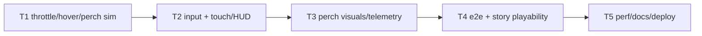

# Plan P5 — Control & Perch

**Goal**: stop the automatic forward flight. Zero throttle hovers; W/S throttle,
Q/E vertical, A/D turn; F perches on ground/roof tops; touch gets the same.

**Architecture**: `src/sim3d/flight.ts` gains throttle/lift/perch state; input
maps keyboard/touch; HUD adds Up/Down/Perch and new copy; Stage slows wings and
shows a perch toast; main exposes read-only telemetry. Story content untouched.

**Tech stack**: unchanged. Commands: `npx vitest run tests/unit`,
`npx tsc --noEmit`, `npm run build`, `npx playwright test tests/smoke`.

**Spec**: `docs/specs/2026-10-26-control-perch.md`.
**Global constraints**: deterministic sim; static; EN/TE; no new dependency;
60 fps target; story objectives remain reachable.

**Review focus**: hover stability/drift; perch snap inside geometry; detach
lifts clear; touch stick axis mapping; old tests still pass; story reachability.

## Tasks

| # | Task | Spec req | Files | Test | Expected | Verify |
|---|------|----------|-------|------|----------|--------|
| 1 | Sim: throttle, hover, vertical, perch, hash | C1–C4, C8 | `src/sim3d/flight.ts`, `tests/unit/control.spec.ts` | control tests | zero throttle stops; W/S/Q/E; perch/detach; deterministic | `npx vitest run tests/unit/control.spec.ts` |
| 2 | Input + touch + HUD copy/buttons | C5, C6 | `src/core/input.ts`, `src/ui/hud.ts`, `tests/smoke/control.spec.ts` | e2e | stick throttle; Up/Down/Perch; copy | `npx playwright test tests/smoke/control.spec.ts` |
| 3 | Perch visuals + telemetry + feedback | C4, C5 | `src/render3/stage.ts`, `src/main.ts` | telemetry e2e | wings slow; toast; `dataset.speed/perched` | Playwright |
| 4 | Story reachability + full regression | C7, C8 | `tests/smoke/**` | all smoke | 14+ green | `npx playwright test tests/smoke` |
| 5 | Perf, docs, deploy | C9 | `docs/qa/perf.md`, `docs/debt-ledger.md`, `README.md` | build + live | live 200; evidence | deploy |

### T1 notes

`FlyInput` adds optional `throttle` and `perch`; old tests remain valid.
`Player` adds `perched`, `perchSurface`. Speed target = throttle*(base+boost),
reverse 0.55; lift = climb*liftSpeed. On zero throttle/climb, drag to zero.
Perch finds nearest ground (y<=min+1.5) or solid top within 2.5 (player above
roof, inside footprint); snap y = top + radius; detach on perch press or
throttle/climb. `perched` in the hash. Bumps unchanged.

### T2 notes

Keyboard: W/S throttle, A/D turn, Q/E climb, F perch, Shift boost, Space sting.
Touch stick: vertical throttle, horizontal turn; add Up/Down/Perch buttons to
the existing Sting/Boost cluster. Update title/briefing controls + touch hint
EN/TE. Input edge for perch.

### T3 notes

Stage: wing flap speed 38 → 9 while perched; no trail while perched; main shows
“Perched”/“Airborne” toast on transition and sets
`canvas.dataset.perched` / `canvas.dataset.speed` each 0.5 s. Camera stays.

### T4 notes

Add e2e: start, hold W 700 ms, release, read `dataset.speed` → near 0; press F
near ground → `dataset.perched=true`; press W → false. Run all smoke; verify
chapter 1 start and one objective still reachable with throttle W.

### T5 notes

Perf rows for hover/perch; docs/README controls; debt (wall perch, auto-snap).
Deploy; live smoke; close.

## Self-review

Coverage C1–C9. Risks: perch threshold vs collision radius (tests), touch stick
mapping (e2e), story reachability (manual smoke). Deferred: wall perch, auto-snap,
reverse-throttle playtest.
