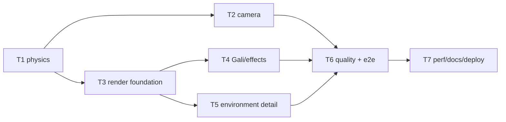

# Plan P4 — Feel & Visual Upgrade

**Goal**: make every chapter look lit, textured and atmospheric, and make flight
feel like flight. No new dependencies, no downloads, no backend.



**Architecture**: the deterministic sim gains velocity/bank/OBB/bumps; the
camera resolves against the same solids; render gains `textures.ts`,
`materials.ts`, `sky.ts`, `glow.ts`, shadow toggling, a redesigned Gali and
detail props. UI adds High/Low quality and a CSS grade layer. Story content and
goals stay unchanged.

**Tech stack**: unchanged. Commands: `npx vitest run tests/unit`,
`npx tsc --noEmit`, `npm run build`, `npx playwright test tests/smoke`.

**Spec**: `docs/specs/2026-10-26-feel-visual.md`.
**World bible**: `docs/research/2026-10-26-eega-world.md`.

**Global constraints**: static only; EN/TE; no film IP; deterministic sim; three
only in render; draw calls <150 high / <90 low; 60 fps target; adaptive quality;
reduced-motion safe.

**Review focus**: physics determinism; collision never teleports/sticks; camera
collision cannot enter walls; story objectives remain reachable; shadow toggle
frees frame time; texture memory; draw calls.

## Tasks

| # | Task | Spec req | Files | Test | Expected | Verify |
|---|------|----------|-------|------|----------|--------|
| 1 | Physics: velocity, accel/drag, bank, smoothed input, OBB slide, bumps | P1, P2, P4 | `src/sim3d/flight.ts`, `src/sim3d/collision.ts`, `tests/unit/flight*.spec.ts` | physics tests | momentum, bank, slide, no teleport, same hash | `npx vitest run tests/unit/flight.spec.ts` |
| 2 | Camera: collision pull-in, bank, boost FOV | P3 | `src/render3/camera.ts`, `src/render3/stage.ts`, `tests/unit/camera.spec.ts` | camera tests | camera stops before walls; bank reads | `npx vitest run tests/unit/camera.spec.ts` |
| 3 | Render foundation: textures, materials, sky dome, shadows, glow, CSS grade | P5, P6, P7, P8, P10 | `src/render3/textures.ts`, `materials.ts`, `sky.ts`, `glow.ts`, `stage.ts`, `src/styles/app.css` | tsc + screenshots | textured lit scenes, fake bloom, shadow toggle | `npx tsc --noEmit` + screenshots |
| 4 | Gali redesign, wing trail, boost lines, car wheels | P8, P9 | `src/render3/models.ts`, `particles.ts`, `stage.ts` | visual | detailed fly, one-wing state, trail | screenshots |
| 5 | Environment detail: lane/workshop/house/diviner/airport/finale | P5 | `src/render3/worlds.ts`, `props.ts` | visual + draw calls | ≥3 texture families + unique cluster per chapter | screenshots + `canvas.dataset.drawCalls` |
| 6 | Quality High/Low toggle, persisted, auto-fallback; e2e | P11, P13 | `src/ui/hud.ts`, `src/main.ts`, `src/core/save.ts`, `tests/smoke/quality.spec.ts` | e2e | toggle persists; low disables shadows; no errors | `npx playwright test tests/smoke/quality.spec.ts` |
| 7 | Perf, docs, deploy, live smoke | P12, P14 | `docs/qa/perf.md`, `docs/debt-ledger.md`, `README.md` | build + live | draw calls/budgets; live 200 | `npm test && npm run build` + live |

### T1 notes

Add to `Player`: `vel{x,y,z}`, `speed`, `roll`, `smoothedTurn`,
`smoothedClimb`. Tuning optional `accel`, `drag`, `turnSmoothing`, `rollLimit`.

```ts
resolveCircleBox(pos, radius, box): { x, z, nx, nz, hit }
```
Use rotated-box closest point. On hit: push out, remove inward velocity, keep
tangential slide, speed loss, push a `World.bumps` entry. Arena edge same.
Same seed + input log → same hash (bumps are render-only, not hashed).

### T2 notes

`ChaseCamera.update(dt,target,yaw,pitch,roll,speed,boost,solids)`:
segment from target to desired camera; find first OBB hit; pull in behind the
player with a 0.15 s lerp; bank camera up-vector by `roll*0.35`; FOV +4° on
boost. Pure `cameraClearance(target, desired, solids)` exported for tests.

### T3 notes

`textures.ts`: concrete/asphalt/wood/marble/paper/fabric/metal/window; 256²
default, 512² hero; cache; `SRGBColorSpace`, repeat. `materials.ts`: textured
Lambert/Standard helpers + emissive. `sky.ts`: shader dome + moon/sun glow;
`sky.setPalette(fog, sky, accent)`. `glow.ts`: radial CanvasTexture + sprite
factory; add to shards/lamps/fire/car/chandelier. `stage.ts`: shadow map high
only, toggle; blob shadow under Gali; CSS grade layer in `index.html/app.css`.

### T4 notes

Gali: thorax/abdomen/head, eye highlights, antennae, 6 legs, stinger, double
iridescent wings, wing blur; body bob/bank. Trail: 2–3 low-life particles per
frame; boost speed lines behind; car wheels spin with actor movement; one-wing
state keeps a visible stump/vein.

### T5 notes

Lane: window grids, AC units, awnings, cables, water tanks, puddles, sign.
Workshop: jars, spools, paper stack, magnifier, shavings, steam. Garva House:
rug, paintings, plants, glassware, skyline. Airport: signs, reflectors,
guardrails. Diviner: drapes, glyph floor texture, charms, candle glow. Finale:
broken glass, embers, fire glow. Keep one material family per cluster reused.

### T6 notes

Save `quality: 'high'|'low'` (v2 tolerant; no version bump). Pause toggle.
`Stage.setQuality`: shadows on/off, pixel ratio 1.5/1.0, detail visibility.
Auto-fallback after 2 s under 48 fps, never auto-upgrade (avoid oscillation).

### T7 notes

Perf table rows for high/low; draw calls; device run debt; docs/README.
Deploy, live smoke, close.

## Self-review

Coverage: P1–P14. Risks: physics tuning vs story targets (test reachability),
camera pull-in jitter (smoothing test), shadow pass draw calls (auto fallback),
texture memory (cache/256). Deferred: real device run, literal shard slot,
remaps.
