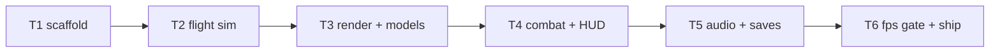

# Plan P0: Vertical Slice — greybox 3D flight

**Goal**: prove full-3D flight plays at 60 fps on mid-tier hardware. Greybox
arena, procedural Gali, one foe type, sting/score/lives, DOM HUD, audio
unlock, fps meter, Pages deploy. No chapters, no menus beyond title/pause.

**Architecture**: `src/sim3d/` fixed-step deterministic flight (pos/vel,
yaw/pitch, seeded RNG, hash); `src/render3/` three.js scene (hemi+dir
lights, fog, chase cam, geometry particles); `src/core/` input/audio/save;
content inline (no chapter data yet).

**Tech stack**: Node 24, three 0.186 (WebGLRenderer, WebGL2 floor), Vite, TS,
Vitest (node env — three imports must stay render-side), Playwright.

**Spec**: `docs/specs/2026-10-26-egara3d.md` (approved).

**Global constraints**: static output only; EN default; no backend; no film
IP (original names); DOM/ARIA UI; audio unlock on gesture.

**Lean constraints**: no physics lib (arcade model); procedural models
(rung 7, smallest that reads); particles = Points (rung 6); audio/i18n/save
patterns ported from 2D (rung 2).

**Review focus**: sim determinism, render/sim separation, draw-call budget,
mobile fps, base-path correctness.

## Tasks

| # | Task | Spec req | Files | Test | Expected | Verify |
|---|------|----------|-------|------|----------|--------|
| 1 | Scaffold: Vite+TS+three, configs, MPA-ready, Pages workflow | P0 setup | `package.json`, `*.config.ts`, `index.html`, `.github/**` | `npm run build` | dist + workflow file | build exits 0 |
| 2 | Flight sim: fixed 1/60 step, yaw/pitch/roll arcade model, bounds, hash | determinism | `src/sim3d/flight.ts`, `tests/unit/flight.spec.ts` | same seed+log → same hash | `npx vitest run` |
| 3 | Render: scene, hemi+dir lights, fog, ground grid→street canyon greybox, procedural Gali + swatter-drone models, chase cam | 60 fps | `src/render3/*` | headless WebGL smoke (no errors) | `npx playwright test` |
| 4 | Combat: sting raycast-by-distance, score, 3 lives, spawn waves, DOM HUD, pause | playable | `src/sim3d/*`, `src/ui/*` | kill/lose paths unit + e2e | vitest + playwright |
| 5 | Audio unlock + mute, best-score save, fps meter overlay | ship | `src/core/*` | no autoplay errors | playwright |
| 6 | Perf protocol + budgets, device run if available, deploy, live smoke | gate | `docs/qa/perf.md` | live 200, fps table row | ship commands |

## Self-review

Coverage: P0 slice requirements mapped. Deferred: chapters, menus, music,
quality tiers, NG+, WebGPU path.
