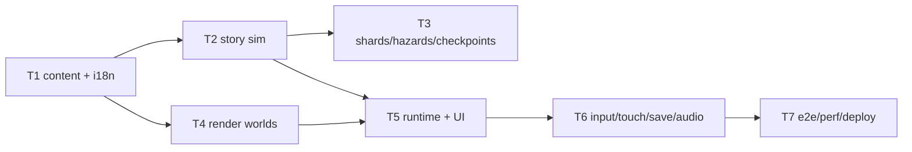

# Plan P1 — Story Mode: framework + chapters 1–3

**Goal**: prove the story loop in 3D. Title → chapter select → briefing → fly →
objectives → shards → debrief, across three distinct fly-scale spaces
(Punnami Lane, the blackout lane/balcony, Shilpi's workshop), with EN/TE text,
save v2, touch input, and a live Pages deploy.



**Architecture**: `src/content3/` typed chapter data (JSON + schema) → `src/sim3d/story.ts`
(deterministic objective/shard/hazard state wrapping the existing flight world) →
`src/render3/worlds.ts` + `props.ts` (procedural chapter scenes) → `src/story/runtime.ts`
(state machine) → DOM UI (`src/ui/`) → `src/core/` (input, save v2, i18n, audio).
Render reads sim state only; the sim never imports three.js.

**Tech stack**: Node 24, three 0.186, Vite 7, TS 5.9, Vitest 5 (node env),
Playwright 1.64. Commands: `npm test`, `npx tsc --noEmit`, `npm run build`,
`npx playwright test`.

**Spec**: `docs/specs/2026-10-26-story-mode-3d.md` (approved).
**World bible**: `docs/research/2026-10-26-eega-world.md`.

**Global constraints**
- Static output only; GitHub Pages project base `/egara-3d/`.
- EN default, TE toggle; all shipped strings in both.
- No film IP: original names/art/audio. No "Eega" in shipped content.
- DOM/ARIA UI; canvas never carries text.
- Audio unlocked on first gesture; mute persists.
- Sim deterministic: same seed + input log → same hash.
- Never import three.js at module top in files under `tests/unit` (node env).

**Lean constraints**
- Reuse P0 flight, camera, particles, audio engine, save parser (rung 2).
- Chapter content is data JSON, not code (rung 7).
- Environments/props/shards are procedural primitives (rung 7); zero downloads.
- Story cards are DOM text (rung 3); no cutscene system.
- Touch is pointer events + a DOM stick (rung 3); no library.

**Review focus**
- Objective sequencing cannot soft-lock; shard/checkpoint loss impossible.
- Chapter scene disposal (no leaked geometries/materials on chapter switch).
- Save v1→v2 migration tolerance; no storage exceptions.
- Draw calls <120; no per-frame allocation in sim or HUD.
- EN/TE completeness; ARIA focus management in menus.
- Base path and live behaviour.

## Tasks

| # | Task | Spec req | Files | Test | Expected | Verify |
|---|------|----------|-------|------|----------|--------|
| 1 | Content schema + chapter defs 1–3 + EN/TE dictionary | R1, R11 | `src/content3/**`, `src/core/i18n.ts`, `tests/unit/content.spec.ts` | schema/coverage test | 8 defs, 3 enabled, 12 shards, all strings EN+TE | `npx vitest run tests/unit/content.spec.ts` |
| 2 | Story sim core: state, objectives (reach/collect/survive/write/destroy), events, hash | R2, R3, R7 | `src/sim3d/story.ts`, `tests/unit/story.spec.ts` | deterministic + objective tests | same seed → same hash; objectives complete in order | `npx vitest run tests/unit/story.spec.ts` |
| 3 | Shards, checkpoints, lives, hazards, paranoia | R4, R5, R6, R7 | `src/sim3d/story.ts`, `src/sim3d/hazards.ts`, `tests/unit/story-hazards.spec.ts` | pickup/death/wind/swatter tests | shards persist, respawn at checkpoint, 3 lives, hazard telegraphs | `npx vitest run tests/unit/story-hazards.spec.ts` |
| 4 | Render worlds: lane, balcony, workshop, hub; props; Shilpi; shards; swatter | R8, R9, R15 | `src/render3/**` | tsc + screenshot | three distinct scenes, hub, no disposal leak, draw calls <120 | `npx tsc --noEmit` + Playwright screenshots |
| 5 | Runtime + DOM UI: title, select, briefing, HUD, cards, pause, debrief | R10, R11, R17 | `src/story/runtime.ts`, `src/ui/**`, `src/main.ts`, `src/styles/app.css`, `tests/smoke/story.spec.ts` | e2e flow | title→ch1→shard→objective→debrief; locked cards; pause; TE toggle | `npx playwright test tests/smoke/story.spec.ts` |
| 6 | Input/touch, save v2 migration, audio layers | R12, R13, R14 | `src/core/**`, `tests/unit/save.spec.ts`, `tests/smoke/touch.spec.ts` | migration + touch tests | v1→v2 keeps mute/best; touch flies; buzz/wind/room/tension layers | `npx vitest run tests/unit/save.spec.ts` + touch e2e |
| 7 | Perf, docs, deploy, live smoke, gate close | R15, R16, R18 | `docs/qa/perf.md`, `docs/debt-ledger.md`, `README.md`, `tests/smoke/live.spec.ts` | build + live | 60 fps headless, live 200, evidence recorded | `npm test && npm run build && LIVE_URL=… npx playwright test tests/smoke/live.spec.ts` |

### T1 notes

`ChapterDef` fields: `id`, `order`, `enabled`, `title{en,te}`, `subtitle{en,te}`,
`location`, `palette{fog,sky,key,fill,accent}`, `bounds{radius,minY,maxY}`,
`spawn{x,y,z,yaw}`, `tuning` (subset overrides), `objectives[]`, `waves[]`,
`shards[]`, `hazards[]`, `cards[]`, `unlock[]`.

Objective kinds: `reach{target,radius}`, `collect{shardIds}`,
`survive{seconds}`, `write{marks[],target}`, `destroy{count}`; `escort`/`boss`
declared for later. Each objective has `id`, `label{en,te}`, `hint{en,te}`.

Ch.1 First Flight: 4 shards, swatter hazard, objective chain
reach balcony → collect 4 shards → survive 20 s → destroy 0? (first strike
bounces: use `reach` Garva's car and a scripted card). Ch.2 The Locket: 4 shards,
wind + blackout beacons, carry the locket, write name. Ch.3 The Workshop: 4
shards, tweezers + lamp, message marks, sting unlock, survive.

Validation: unique chapter/shard/objective ids; 12 shards across enabled
chapters; every string has `en` and `te`; bounds positive; spawn inside bounds;
enabled chapters contiguous from order 1.

### T2 notes

```ts
interface StoryState {
  chapter: ChapterDef;
  world: World;            // flight, foes, collision
  objectiveIndex: number;
  objectiveProgress: number[];
  shards: Record<string, boolean>;
  paranoia: number;
  checkpoint: Vec3;
  lives: number;
  elapsed: number;
  events: StoryEvent[];
  phase: 'playing' | 'complete' | 'failed';
}
createStoryState(seed: number, chapter: ChapterDef, solids: Building[]): StoryState
stepStory(state: StoryState, input: FlyInput): void
hashStory(state: StoryState): string
```
`stepStory` runs one fixed flight step, then evaluates the current objective,
pickups, hazards, paranoia, and pushes events (`shard`, `objective`, `hurt`,
`respawn`, `write`, `complete`). `hashStory` = world hash + objective index/progress
+ shard bits + lives + paranoia (quantised).

### T3 notes

- Shard pickup radius 1.6; once collected, never respawns; checkpoint = shard pos.
- Death: lives--, if 0 → respawn at checkpoint, lives=3, invuln 90, event `respawn`;
  shards kept; no score loss.
- Wind zone: cylinder (x,z,r,y range, strength) pushes player each step; visible
  dust particles; audio layer inside.
- Swatter: moves on a fixed path, telegraph 60 frames (shadow + wind-up), active
  30 frames; contact = hurt.
- Tweezers: kinematic moving capsule; lamp: heat sphere; contact = hurt.
- Paranoia: `+0.02/s` outdoor + sabotage events; clamps 0–100; drives light
  intensity and drone count via render/audio only.

### T4 notes

- `worlds.ts`: `buildLane(palette)`, `buildBalcony(palette)`, `buildWorkshop()`,
  `buildHub()`. Shared `buildArenaLayout` for collision in the lane; balcony and
  workshop use explicit solids in chapter data.
- `props.ts`: locket, needle, matchbox, mug, satellite dish, cables, window
  grille, lamp, glass wing, shard, swatter, tweezer, Garva car (silhouette).
- `models.ts`: add `buildShilpi()` (stylised low-poly: head, torso, arms, hands;
  no likeness), `buildGarvaCar()`.
- `stage.ts`: `loadChapter(def)`, `loadHub()`, `disposeWorld()`, per-chapter
  palette/fog/lights, sync shards/swatter/Shilpi, fade overlay. Track
  `renderer.info.render.calls`; expose `drawCalls`.
- Screenshot each scene at 960×540; verify scale (Gali small vs hand/locket).

### T5 notes

Runtime states and transitions per spec §7. `main.ts` becomes a thin composition
root. HUD additions: `setObjective`, `setShards`, `setParanoia`, `showCard`,
`showDebrief`, `showChapterSelect`, `setLang`. Chapter select cards are buttons
with `aria-disabled` for locked chapters. Focus trap in dialogs; Escape closes.
First run skips select and opens ch.1 briefing.

### T6 notes

Save v2 pure parser: accept v1 `{v:1,muted,best}` and unknown fields; reject
invalid chapters/shards; clamp best. Touch: left half pointer → virtual stick
(deadzone 0.15), right half drag → look, two buttons (sting, boost) bottom-right;
pointer capture; no page scroll. Audio: `setLayer('buzz'|'wind'|'room'|'tension', 0..1)`
with oscillators/gain; stingers reuse `play()`; stop layers on pause.

### T7 notes

Perf row for headless Chromium and a desktop run if available. Debt ledger gets
deferred items (device fps run, ch.4–8, boss nodes, remaps). README status.
Deploy via push; bootstrap Pages only if the workflow fails; live smoke; close
gate after evidence.

## Self-review

Coverage: R1–R18 mapped to T1–T7. No task adds a dependency. T4 is the largest
risk (scene disposal/perf) and is isolated behind `Stage.loadChapter`. Deferred:
ch.4–8, bosses, NG+, device fps run, remaps (recorded in debt ledger).
