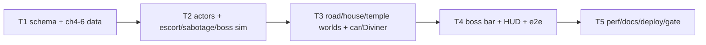

# Plan P2 — Story Mode: chapters 4–6

**Goal**: extend the story gate through the midpoint reversal. Airborne car
chase and write-on-glass, the three pillars of Garva's house, and the Diviner
boss. Each chapter gets one new verb, a paranoia-driven escalation, and a
dialogue-free story beat. No new dependencies.



**Architecture**: `src/content3` gains `actors`, `boss`, `escort`/`sabotage`/`boss`
objectives, `fire`/`smoke` hazards and paranoia waves. `src/sim3d/story.ts` gains
kinematic actors, a shared `targetPosition()` resolver, sequential sabotage
nodes, fire damage, and paranoia-triggered waves. `src/render3/worlds.ts` gains
the airport road, Garva House atrium/ledger room, and Diviner room; `models.ts`
gains the Diviner. `src/ui/hud.ts` gains a boss bar. Everything else reuses P1.

**Tech stack**: unchanged. Commands: `npx vitest run tests/unit`,
`npx tsc --noEmit`, `npm run build`, `npx playwright test tests/smoke`.

**Spec**: `docs/specs/2026-10-26-story-mode-3d.md` (approved; P2 phase in §10).
**World bible**: `docs/research/2026-10-26-eega-world.md`.

**Global constraints**: static only; EN/TE; no film IP; DOM/ARIA; audio gesture
unlock; deterministic sim; three.js only in render; draw calls <120.

**Lean constraints**: reuse P1 objective/card/HUD/save machinery; actors are
kinematic data, no physics; boss is three target nodes, no AI state tree; fire
and smoke are sphere hazards; worlds are primitives; no new dependency.

**Review focus**: escort cannot soft-lock if the car outruns the player;
sabotage/boss target order is forgiving; fire cannot trap a spawn/checkpoint;
paranoia waves fire once; boss bar clears on pause/debrief; draw calls.

## Tasks

| # | Task | Spec req | Files | Test | Expected | Verify |
|---|------|----------|-------|------|----------|--------|
| 1 | Schema + chapters 4–6 data + EN/TE cards | R1, R8 | `src/content3/**`, `tests/unit/content.spec.ts` | content validation | 6 enabled chapters; ch4–6 have actors/boss/hazards | `npx vitest run tests/unit/content.spec.ts` |
| 2 | Sim: actors, escort, sabotage/boss, fire, paranoia waves | R2, R3, R6, R7 | `src/sim3d/story.ts`, `tests/unit/story-actors.spec.ts` | actor/objective/hazard tests | car moves and stops; escort completes; 3 nodes break; fire hurts; waves once | `npx vitest run tests/unit/story-actors.spec.ts` |
| 3 | Render: airport road, Garva House, Diviner room, car, Diviner, fire/smoke | R8, R9 | `src/render3/**` | tsc + screenshots | three distinct spaces; car follows actor; boss reads | `npx tsc --noEmit` + screenshots |
| 4 | HUD boss bar, chapter select 0/0 handling, e2e | R10, R17 | `src/ui/hud.ts`, `src/main.ts`, `tests/smoke/story-p2.spec.ts` | e2e | boss bar shows/clears; ch4 locked until ch3 done; continuous flow | `npx playwright test tests/smoke/story-p2.spec.ts` |
| 5 | Perf, docs, deploy, live smoke, gate close | R15, R16, R18 | `docs/qa/perf.md`, `docs/debt-ledger.md`, `README.md` | build + live | draw calls <120; live 200; evidence | `npm test && npm run build` + live |

### T1 notes

`ChapterDef` additions: `actors: ActorDef[]`, `boss?: {id, name, nodes}`.
`ObjectiveDef` additions: `actorId`, `targets`, `bossId`. `WaveDef.atParanoia`.
`HazardDef.activeAfterObjective`. `HazardKind` already includes fire/smoke.

Ch.4 Airport Road: car actor path `(0,2,90)→(0,2,-50)`, speed 14; spawn
`(0,8,105)` facing −z; escort 10 s radius 14 → write 4 marks relative to the car
→ survive 10 s → reach the wreck. Wind gusts; a fire starts after the write.
Ch.5 Garva House: reach atrium → sabotage three pillars (chandelier, safe,
ledger) → survive 15 s as fire spreads → reach the exit. Each pillar raises
paranoia by 25; a guard wave fires at paranoia 50.
Ch.6 Diviner: break three ritual charms (boss nodes) → survive 20 s in the
burning room → reach the exit. Smoke is visual; fire damages after the boss.
Boss bar name: The Diviner.

No new shards: the twelve are the P1 set; ch4–6 cards carry the story.

### T2 notes

```ts
interface ActorRuntime { id; x; y; z; pathIndex; done; }
interface StoryState { actors: ActorRuntime[]; nodeIndex: number; interactCooldown: number; }
function actorPosition(state, id): Vec3 | null
function targetPosition(state, objective, index): Vec3 | null
```
Escort: accumulate while inside radius; decay outside; complete at `seconds`.
Sabotage/boss: press sting within radius of `targets[nodeIndex]`, 30-frame
cooldown, +25 paranoia per node for sabotage, emit `objective`/`kill`-style event.
Fire: loses a life inside radius; skip until `activeAfterObjective`.
Paranoia wave: fires once when `paranoia >= atParanoia`.
`hashStory` includes actors and node index.

### T3 notes

`buildAirportRoadWorld`: highway, barriers, sodium lamps, distant skyline, no
buildings; moving car group bound to actor. `buildGarvaHouseWorld`: atrium,
columns, chandelier, mezzanine, glass wall, ledger room, safe; `buildDivinerWorld`:
ochre cloth, hanging charms, candles, smoke planes, ritual circle, robed
Diviner. Fire/smoke visuals from hazard runtime. Chapter 4 car is an actor; ch1
static car stays.

### T4 notes

`Hud.setBoss(name, remaining, total)` + `hideBoss()`; bar top-center with ARIA
label. `syncHud` shows when `chapter.boss` and current objective is the boss;
hides otherwise and on pause/debrief. Chapter select shows `—` instead of
`0/0` when a chapter has no shards. E2E: seed a save with ch1–3 done, start ch4,
assert boss bar absent, assert ch5/6 selectable; assert ch6 boss bar appears
after starting ch6 (via chapters).

### T5 notes

Perf rows for ch4–6; draw calls; adaptive scale. Docs/README/debt. Deploy,
live smoke, close.

## Self-review

Coverage: R1–R18 mapped across T1–T5; P2 spec §10. No new dependency. Main risks:
escort tuning (T2 tests + spawn boost), car/render sync (T3 screenshot), boss bar
lifecycle (T4 e2e). Deferred: Garva four-node web, NG+, device perf.
