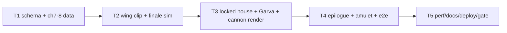

# Plan P3 — Story Mode: chapters 7–8, Garva, epilogue

**Goal**: finish the story gate. Infiltrate the locked Glass House, recover
Venu's policy, free Shilpi; break Garva's four pillars, lose a wing, survive the
needle, and fire the cannon. Unlock the wing amulet and the epilogue.

**Architecture**: reuses P2 actors/sabotage/boss/fire. Adds
`wingClipAfterObjective`, `StoryState.wingClipped` (tuning mutation + one hidden
wing), `bonusLives` for the amulet, `buildGarva`/finale props, and an epilogue
screen. No new dependency.

**Spec**: `docs/specs/2026-10-26-story-mode-3d.md` (P3 phase in §10).
**World bible**: `docs/research/2026-10-26-eega-world.md`.

**Global constraints**: static only; EN/TE; no film IP; DOM/ARIA; deterministic
sim; three.js only in render; draw calls <120; 60 fps target with adaptive scale.

**Lean constraints**: reuse the boss/sabotage objective machinery; wing clip is
one deterministic tuning mutation; Garva is a procedural low-poly figure; cannon
is a prop + one sabotage target; epilogue is a DOM screen.

**Review focus**: wing clip cannot soft-lock the finale (cannon reachable at
reduced speed); bonus life is deterministic and saved; epilogue only after ch8;
boss bar clears; draw calls in the finale.

## Tasks

| # | Task | Spec req | Files | Test | Expected | Verify |
|---|------|----------|-------|------|----------|--------|
| 1 | Schema + ch7/8 data; enable all 8; validation | R1, R8 | `src/content3/**`, `tests/unit/content.spec.ts` | content tests | 8 enabled; ch7 policy/case; ch8 4-node boss + clip + cannon | `npx vitest run tests/unit/content.spec.ts` |
| 2 | Sim: wing clip, bonus life, ch7/8 objectives, hash | R2, R3, R8 | `src/sim3d/story.ts`, `src/story/runtime.ts`, `tests/unit/story-finale.spec.ts` | finale tests | clip applies once; speed/boost drop; cannon reachable; amulet +1 life | `npx vitest run tests/unit/story-finale.spec.ts` |
| 3 | Render: locked house props, Garva, cannon, cylinder, one-wing Gali | R8, R9 | `src/render3/**` | tsc + screenshots | ch7/ch8 read; Garva looms; clipped wing visible | `npx tsc --noEmit` + screenshots |
| 4 | Epilogue, amulet slot/badge, finale debrief, e2e | R10, R17 | `src/ui/hud.ts`, `src/main.ts`, `tests/smoke/story-p3.spec.ts` | e2e | ch7/8 unlock; boss bar 0/4; epilogue after ch8; amulet badge | `npx playwright test tests/smoke/story-p3.spec.ts` |
| 5 | Perf, docs, deploy, live smoke, gate close | R15, R16, R18 | `docs/qa/perf.md`, `docs/debt-ledger.md`, `README.md` | build + live | draw calls <120; live 200; evidence | `npm test && npm run build` + live |

### T1 notes

Ch.7 The Glass House: reach the vent → take Venu's policy (sabotage 1) → free
Shilpi from the glass case (sabotage 1) → reach the exit. Lockdown searchlights,
swatter, guard waves; paranoia wave at 50. Cards reveal Venu's insurance murder.

Ch.8 The Cannon: break Garva's four pillars (boss 4) → survive the needle (15 s,
wing clipped) → fire the cannon (sabotage 1). `wingClipAfterObjective: 0`.
All 8 chapters enabled; unlocks ch7→ch8, ch8→[].

Amulet decision: the story has a fixed 12-shard set, so the amulet is shown as a
golden **amulet slot** in the HUD/chapter select and grants **+1 life** on every
replay. This is the P3 interpretation of "+1 shard slot": a visible slot plus a
second chance. Recorded here; no spec widening.

### T2 notes

`createStoryState(seed, chapter, bonusLives = 0)` raises `tuning.player.lives`.
`StoryRuntime.openBriefing` passes `save.amulet ? 1 : 0`.
`applyWingClip`: once, when `objectiveIndex > wingClipAfterObjective`:
`speed *= 0.65`, `boost = 0`, `yawRate *= 0.85`, event `wingClip`, hash bit.
Stage hides the right wing and main emits smoke/toast. Ch8 cannon must be
reachable at 65% speed from the needle arena; test the distance/time.

### T3 notes

Garva: tall suited figure, 28 units, no likeness; four pillar nodes around him.
Cannon + steel ball; oxygen cylinder; needle hazard uses a scaled needle mesh.
Glass House reuses the atrium with fire and broken glass. Ch7 adds a glass case
with a locket, a vent grate, and searchlight cones.

### T4 notes

`Hud.showEpilogue({amulet, body, onClose})`; finale debrief button "The Wing".
Amulet badge on title/select/debrief when `save.amulet`. Ch8 debrief always
offers the epilogue; the amulet requires all 12 shards (P1 set). E2E: seed ch1–6
done, ch7 enabled; ch8 after ch7; boss bar `Garva 0/4`; epilogue button.

### T5 notes

Perf rows for ch7/ch8; draw calls; docs/README/debt; deploy; live smoke; close.

## Self-review

Coverage: R1–R18; P3 §10. Risks: clipped flight tuning vs cannon reach (test),
finale draw calls (screenshot/perf), epilogue lifecycle (e2e). Deferred: literal
shard-slot inventory, device run, remaps.
