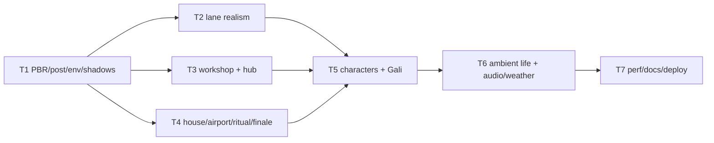

# Plan P6 — World Realism

**Goal**: make Nagaram read like a real, lived-in Indian metro at fly scale.
PBR light/material realism, cinematic post, dense original set-dressing,
ambient humans/animals/vehicles, richer sound. High/low tiers.

**Architecture**: three.js addons for EffectComposer/bloom/grade and PMREM env;
`materials.ts` returns PBR with bump maps; Stage swaps to Lambert/no-post on low.
Worlds gain detail modules and InstancedMesh clusters; `ambient.ts` adds humans/
animals/vehicles; `audio.ts` adds city/fire/rain layers.

**Tech stack**: unchanged + three examples addons already shipped in the package.
Commands: `npx vitest run tests/unit`, `npx tsc --noEmit`, `npm run build`,
`npx playwright test tests/smoke`.

**Spec**: `docs/specs/2026-10-26-world-realism.md`.
**IP boundary**: original assets only; no stills, likenesses, songs, dialogue or
shot copies.

**Review focus**: high/low material swap restores correctly; post composer
resolution/quality; draw calls; shadow cost; ambient actors deterministic-free
(render only); story/controls unchanged; live.

## Tasks

| # | Task | Spec req | Files | Test | Expected | Verify |
|---|------|----------|-------|------|----------|--------|
| 1 | PBR materials, PMREM env, bloom/grade post, 2048 shadows, low-tier swap | W1, W2 | `src/render3/materials.ts`, `stage.ts`, `post.ts`, `tests/unit/materials.spec.ts` | tsc + screenshots | high cinematic; low flat-fast; toggle clean | `npx tsc --noEmit` + shots |
| 2 | Lane realism: shopfronts/temple/tea stall/auto/scooters/animals/lights/transformer | W3 | `src/render3/worlds.ts`, `props.ts`, `ambient.ts` | visual + calls | ≥8 clusters; lived-in lane | screenshots + calls |
| 3 | Workshop + hub realism: tools/jars/sketches/locket/dawn/city | W4 | same | visual | ≥6 clusters; macro workshop | screenshots |
| 4 | Garva House + airport + ritual + finale realism | W5, W6 | same | visual | ≥8 house clusters; terminal/planes; brass/smoke; fire/glass | screenshots |
| 5 | Gali/Shilpi/Garva/Diviner realistic proportions + clothing/detail | W8 | `src/render3/models.ts` | visual | detailed, no likeness | screenshots |
| 6 | Ambient humans/animals/vehicles + city/fire/rain audio + weather particles | W7, W9 | `src/render3/ambient.ts`, `worlds.ts`, `src/core/audio.ts` | audio smoke | idle life; layers per chapter | e2e/no errors |
| 7 | Perf tiers, docs, deploy, live | W10, W11 | `docs/qa/perf.md`, `docs/debt-ledger.md`, `README.md` | build + live | draws/perf rows; live 200 | deploy |

### T1 notes

`textured(kind,color,...)` → `MeshStandardMaterial` with map+bumpMap,
roughness/metalness; `windowMaterial` PBR. `Stage` high: PMREM env from
`RoomEnvironment` (`environmentIntensity` 0.35), 2048 shadow map, EffectComposer
(RenderPass → UnrealBloomPass → grade ShaderPass → OutputPass). Low: cached
Lambert clones, no composer, no shadows, direct render. `setQuality` swaps all
mesh materials and restores high. Composer resizes with render scale.

### T2 notes

Lane: two rows of shopfronts with shutters/awnings/signs; a small temple corner
with bell/oil lamps; tea stall with kettle/steam; auto-rickshaw + scooters; street
dog and pigeons; festival string lights; transformer/blackout; laundry; water
tanks; puddles; signage in EN/TE. Repeated windows/ACs/lamps via InstancedMesh
where practical.

### T3 notes

Workshop: pinned sketches, locket stand, thread rack, jars, tool tray, paper
stack, magnifier, dawn shaft, dust; hub: city window, amulet, wing, keepsakes.
### T4 notes

House: marble, art, plants, bar, chandelier, skyline, cameras, guards, safe,
ledger. Airport: terminal silhouette, plane, traffic, gantries, toll, signs.
Ritual: brass, charms, cloth, powder circle, smoke. Finale: fire, broken glass,
embers, cannon, oxygen.
### T5 notes

Gali compound eyes/wing veins/hairs; Shilpi sari/bangles/bindi; Garva suit/lapels/
watch; Diviner robes/beads. No actor likeness; faces stylised.
### T6 notes

Ambient humans (shopkeeper, passer-by, guard, child) idle loops; dog, pigeons,
cat; auto/scooter/plane; paper/dust/rain/embers; audio city hum/traffic/bell/
birds/fire/rain.
### T7 notes

High/low draw calls + fps rows; docs/README; deploy; live smoke; close.

## Self-review

Coverage W1–W11. Risks: post + shadows cost; material swap; scene density draw
calls; time. Deferred: CC0 asset packs, DOF, photoreal faces.
