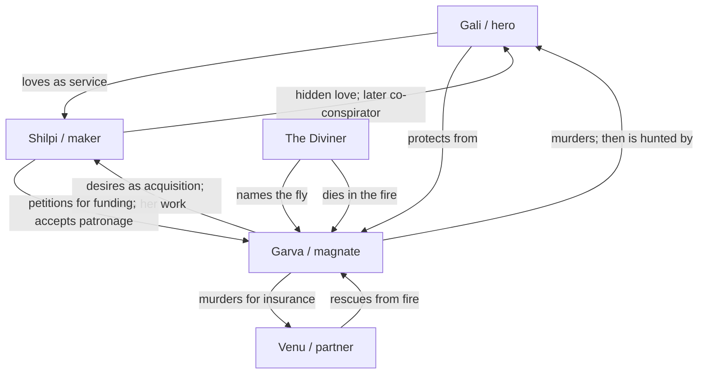
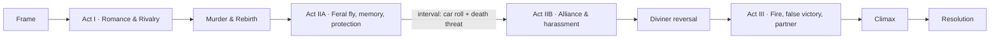

# Egara 3D — World Bible

Built from a study of *Eega* (2012, dir. S. S. Rajamouli) for structure, character
logic, world-building and escalation. Research date: 2026-10-26. Four parallel
streams; ~30 sources reviewed; claims labelled where confidence is not high.

**How to use this document.** Sections 1–5 analyse the film. Sections 6–11 are
the binding canon for *Egara 3D*. The film is named only in this research file;
shipped content uses original names, places, art and audio. No stills, posters,
likenesses, songs, lyrics or verbatim dialogue.

---

## 1. The film's world in one page

A murdered young man returns as a housefly and, with the woman he loved, wages an
escalating campaign against the industrialist who killed him. Rajamouli called it
a **socio-fantasy** — not science fiction — built on a David-vs-Goliath frame:
the hero has no superpowers, only fly abilities, human cunning and an ally who
can build tiny things [1][4][8].

The world runs on three material domains, each owned by one character:

| Domain | Owner | Scale of power | What it means |
|---|---|---|---|
| Fireworks | the hero | small explosions | craft, improvisation, sacrifice |
| Miniatures | the maker | precision at fly scale | care, patience, hidden value |
| Construction / steel / glass | the magnate | crore-scale projects | capital, visibility, control |

The finale fuses all three: gunpowder + needle/cannon + mansion. The film keeps
shrinking the unit of decisive action until the smallest thing wins [1][4][5].

**World rules (high confidence).** Death is transformation, not an ending. The
fly has no voice, no superpowers and initially no memory; memory returns through
encounters with the two people who matter. The occult is real but mercenary — a
billionaire buys a ritual the way he buys a contract. The human world is giant,
tangible and physical: full-size sets, macro lenses, practical objects [1][2][8].

---

## 2. Characters and arcs (film analysis)

### Nani / the fly — the lover who becomes a weapon

- **Before death:** a light-hearted neighbourhood suitor who works in fireworks;
  playful, physically expressive, non-heroic. He makes small things that produce
  outsized explosions — literally the climax's method [1][6].
- **Want:** to be chosen openly by Bindu. **Need:** to turn performance into
  sacrifice — to act for her rather than perform for her. **Fear:** that his life
  and death amount to nothing.
- **Cost of rebirth:** body, voice, name and initially memory. He gains speed,
  flight, anonymity and ubiquity. He cannot speak; he writes — a threat scratched
  into a shattered windshield, his name traced in tears [1][5].
- **Arc:** playful suitor → murdered the same night Bindu finally confesses by
  phone → amnesiac insect running on instinct → recognition → guardian/terrorist
  → strategist who weaponises household objects and the maker's craft → martyr
  who dies a second time → reborn guardian in the epilogue [1].
- **Key turns:** the dying vow is conditional on Sudeep harming Bindu, not on his
  own murder — revenge framed as guardianship, not grievance [1]. The windshield
  message. The tear-written name. The black-money fire. The clipped wing and the
  self-immolating cannon shot.
- **Dialogue-free performance:** eyes occupy most of the head; expression comes
  from eye shape, head tilt, hover rhythm, wing pitch and slender limbs. The
  *Luxo Jr.* short was the reference. The film plays as a heightened silent movie;
  the villain's reactions carry the hero's characterisation [1][3][4][6].
- **Theme:** love as service, not possession. He is a ghost, not a superhero.
- **Game lesson:** scale is the core verb; combat is chain-reaction trap-crafting,
  never damage-per-second; death is a transformation, not a fail state.

### Bindu — the patronised professional who becomes a co-conspirator

- **Position:** miniature/micro artist who runs a donation-funded NGO; independent,
  socially mobile, professionally serious. She petitions a billionaire for money
  and secretly returns Nani's feelings [1][6].
- **Relationship with Sudeep:** she reads the grant as patronage; he reads it as a
  down payment on her. Her neutrality is the plot's fuse [1].
- **Arc:** object of rivalry → mourner → recipient of the fly's revelation →
  co-conspirator who arms and shelters him → captive used as leverage → survivor
  who memorialises him with a wing amulet → protected again in the epilogue [1].
- **Pivot:** the fly spells its name in her tears; she chooses to believe it. Her
  miniature craft, planted as a quirk, becomes the mechanism by which she arms
  him [4][6].
- **What she sacrifices:** patron, platform, safety, respectability, and Nani
  twice. Her one direct act of violence — a box-cutter defence — fails [1].
- **Critique to keep visible:** she becomes active, but her action is support-shaped
  (arming, signalling, distracting). Her competence is instrumentalised for the
  hero. Do not smooth this over; give her refusals and her own goals.
- **Theme:** the difference between being loved and being owned — and the cost of
  being the thing two men fight over.
- **Game lesson:** ally AI built on legibility, not obedience; her studio is the
  upgrade bench; trust gates upgrades, not currency.

### Sudeep — the industrialist who owns everything except his own image

- **Backstory deliberately absent.** He arrives complete: mansion, staff, cars,
  charity events, investors, a personal assistant, a business partner. The absence
  is the characterisation — his power is an institution, not a wound [1].
- **Psychology:** narcissism plus entitlement. He cannot process refusal. He kills
  not in a rage but as administration — abduction, strangulation, staged accident,
  then back to normal life. Murder is a logistics problem he expects to close [1].
- **Source of power:** money, corporate structure, staff, social deference,
  physical size, and **legibility** — contracts, meetings, ministers, insurance,
  reputation. The fly attacks what cannot be audited: sleep, sanity, dignity,
  hidden cash, household wiring.
- **Self-image:** the great benefactor, the rational modern industrialist. He
  believes he is civilised, so the fly does not merely hurt him — it makes him
  ridiculous in front of staff, investors, a sorcerer, a minister.
- **Arc:** confident predator → irritated suitor → killer who believes the problem
  is closed → disbeliever in "a mere fly" → public comedy victim → paranoia →
  abandons his rationalist identity by hiring a tantric → financial ruin when
  hidden black money burns → near-death in his own house fire → murders the partner
  who saved him for insurance → besieged captor in his own mansion → killed by a
  miniature cannon firing a steel ball through his chest into an oxygen cylinder [1].
- **Fear:** public humiliation; being small; losing control. His nightmare is
  indignity, not death — which is why the film denies him a dignified death.
- **Beyond "rich villain":** he is funny (played as "a bad guy, not a villain",
  with Tom-and-Jerry / Disney energy [7]); he is the audience's surrogate, since
  there is no human hero to watch [2][7]; and he is systemic — every defeat is
  refinanced from another domain (money → guards; fear → ritual; partner →
  insurance).
- **Game lesson:** boss as institution, not health bar. Model him as a resource web
  (reputation, capital, staff loyalty, occult cover); destroy nodes in any order;
  each node rewires patrols and geometry. Paranoia is a visible world state, not a
  UI meter. He always refinances.

### Supporting cast — the world's texture

- **The tantric sorcerer.** Paid ritual specialist who identifies the fly as the
  dead man. He validates the supernatural rules, offers a false solution, and dies
  in the fire his client started — a Bhasmasura echo: the invoked power destroys
  the invoker [1]. The occult is low-status, mercenary and sits *beside* corporate
  India; a billionaire hiring a sorcerer is itself a status collapse.
- **Adithya, the business partner.** Pulls Sudeep from the burning house, then is
  murdered for a ₹700 crore insurance payout [1]. Proves Sudeep's relationships are
  balance-sheet items; the rescue creates the debt that gets him killed.
- **The personal assistant.** Comic witness and household chorus — the staff
  register the loss of dignity Sudeep cannot admit [1].
- **Nani's friend Noel.** Grounds Nani as a social being outside the romance [1].
- **The drunken thief.** A comic admirer whose thread pays off after the climax:
  Bindu is harassed while travelling and the reborn fly attacks the aggressor. He
  parodies the hero's own "loyal follower" courtship — the same behaviour reads as
  predation once charm is removed — and proves ordinary male predation did not end
  with Sudeep [1][6].
- **Family / priest / colleague.** Domestic normalcy, folk-religious texture and
  workplace ordinariness. The world is one where ritual, family reputation and
  superstition are simply furniture — which is why the tantric plot lands without
  a genre break [1].

### Relationship engines

- **Love vs possession.** One gives his body twice and asks nothing; the other
  gives money and expects a person. The film literalises the difference — one
  sacrifices, the other acquires [1][4].
- **Gift vs transaction.** The donation is the thesis object: a grant to her, a
  purchase to him. When the purchase is refused he converts money into violence,
  then into insurance — same ledger, different line item [1].
- **Public status vs private emptiness.** The mansion is a stage set; the black
  money hidden inside it is literally combustible rot. The fly's campaign makes
  the private self public — the only thing Sudeep cannot survive [1].
- **Scale as moral geometry.** Fireworks maker (small explosions), micro-artist
  (fly scale), industrialist (crore scale). The unit of decisive action keeps
  shrinking until the smallest thing wins [4][5].

---

## 3. World-building: geography, class, materials

The film is set in an unnamed Indian metro, shot mostly at Ramanaidu Studios,
Hyderabad [1]. The analysis below separates sourced facts from design read.

### The neighbourhood lane and the maker's apartment — communal, owned by nobody

- **Function:** the street is the social stage; her apartment is the emotional
  centre. A neighbourhood power cut is solved with a satellite dish, tin foil and
  a torch — care made from junk [8].
- **Visual signature (design read):** dense low-rise, balconies, window grilles,
  tangled cables, warm practical light, blackout.
- **Class meaning:** improvisation and mutual care vs purchased control.
- **Gameplay affordances:** rooftop-to-balcony flight lines; grilles as gates and
  perches; clotheslines and aerials as rails and hazards; satellite dish as
  reflector/updraft; open windows as interior transitions; blackout turns light
  sources into objectives.

### The micro-art workshop — precision, patience, hidden value

- **Function:** love is physically made here — a heart locket carved from pencil
  lead, finished with the hero's help [1][7].
- **Visual signature:** bench-top scale, magnifier lamp, tweezers, lead shavings,
  fine dust.
- **Class meaning:** value created at a scale nobody notices — a gift economy
  against an extraction economy. The craft later arms the fly [4][7].
- **Gameplay affordances:** crafting/upgrade hub; magnifier lamp as moving light
  and scale-bending lens; tweezers, needles and shavings as platforms/hazards; dust
  as soft cover; a "hold still while the human works" stealth beat.

### The magnate's mansion and skeet range — glass, height, exposure

- **Function:** the skeet range introduces him, the mansion hosts his party, and
  the house becomes the final arena [1][7].
- **Visual signature:** double-height atrium, glass, steel, marble, polished
  floors, terrace, chandeliers — a display case. The climax uses a power failure
  and a slow dark-to-bright lighting transition [2][7].
- **Class meaning:** wealth as visibility and invulnerability. The same openness
  that displays status lets the fly in; his monument becomes his trap.
- **Gameplay affordances:** vertical atrium for dives and chandelier-perch stealth;
  AC vents as fast travel and escape; reflective floors/glass as disorientation and
  duplicate-silhouette puzzles; skeet range as ballistics tutorial; security lights
  and shutters as dynamic lockdown.

### The airport road — public infrastructure; speed, machines, exposure

- **Function:** the magnate drives the maker to the airport; the fly intercepts,
  causes a crash, then scratches a death threat into the shattered windshield [1].
- **Class meaning:** the chauffeured private world meets public infrastructure and
  fails; control breaks in front of witnesses.
- **Gameplay affordances:** convoy escort/race at windshield height; slipstream and
  crosswind; wiper sweep as timed hazard; window gaps as entry points; write-on-glass
  as message/navigation; tumbling car interior as a moving obstacle course.

### The ritual space — the occult inside the house

- **Function:** the magnate consults a tantric who reveals the fly's identity; the
  priest dies in the mansion fire. The ritual and the fly-trap collapse into the
  same location [1]. **Standalone set design: insufficient data.**
- **Design read:** smoke, ochre/red cloth, hanging metal charms, powder circles,
  flame, low visibility.
- **Class meaning:** a pre-modern remedy purchased inside a modern capitalist
  house; magic as another service.
- **Gameplay affordances:** smoke limits sight and forces audio navigation; ember
  updrafts and candle flames as lifts/hazards; swinging charms and vessels as
  moving cover; ritual circle as a state-changing zone; follow-the-chant checkpoint.

### The finale interior — the mansion as furnace

- **Function:** the fly fights the magnate among domestic objects; the house burns.
  Power failure, low light, then light gradually returns [2].
- **Props in play:** sewing needle, box cutter, match, household gunpowder,
  miniature decorative cannon, steel ball, oxygen cylinder [1].
- **Class meaning:** ornaments become weapons; the industrial oxygen cylinder kills
  the industrialist. Domestic scale defeats corporate scale.
- **Gameplay affordances:** shrinking arena with spreading fire as timer; chain
  reaction (match → powder-coated fly → cannon → cylinder); needle as hazard and
  precision weapon; one-wing escape with asymmetric flight; collapsing beams as a
  vertical gauntlet.

### Prop and motif inventory

| Prop | Story function | Gameplay use |
|---|---|---|
| Pencil-lead heart locket | Love token; proof of humanity; her craft [1] | Collectible/checkpoint; crafting key; fragile escort object |
| Sewing needle | Wounds the magnate; later kills the fly [1] | Precision weapon and lethal hazard; pierce attack with risk |
| Box cutter | Her attempted self-defence [1] | Dropped human weapon; temporary pickup; blade hazard |
| Match + household gunpowder | The fly coats himself, leaps through flame, fires the cannon [1] | One-use sacrifice ability; ignition/chain-reaction trigger |
| Miniature cannon + steel ball | Delivers the killing shot [1] | Launch pad; aimed projectile puzzle; finisher |
| Oxygen cylinder | Explodes after the cannon shot [1] | Environmental chain-reaction target; area denial |
| Shattered windshield | Surface for the death threat [1] | Write-on-glass navigation/message |
| Tears | Ink for the hero's name [1][8] | Liquid-surface reveal; tracking mechanic |
| Goggles, armour, tiny weapons | She equips him for the campaign [7] | Upgrade tree; visual progression |
| Satellite dish + foil + torch | Improvised light during a power cut [8] | Reflector/beam puzzle; blackout navigation |
| Magnifier + pencil | Her micro-art tools [10] | Scale-bending lens; crafting/scanning |
| Wing / amulet | She keeps the detached wing [1] | Endgame relic; respawn/legacy motif |
| Insecticide can | Suspense beat [8] | Area-denial hazard; stealth fail state |

### Visual grammar

- Macro probe lenses at f/8+, room-filling light; deep focus, texture-rich, not
  shallow bokeh [2][3].
- High-speed photography above 2,000 fps against a 24 fps norm; time dilation makes
  wingbeats and impacts readable [2][3].
- GoPro for impossible placements; cranes for continuous flight moves [1][2][3].
- Previsualised like a game: a 3D video of the storyboard consulted daily;
  greyscale animatics for editing and re-recording [1].
- The human world was performed against nothing; the fly was inserted later — the
  giant world is staged for a camera at fly height [3].
- Fly POV and loop-the-loop camera; images, not dialogue, carry the story after
  rebirth [8].
- Scale is sold by cropping the human: low placement, macro compression, objects
  that overflow frame — the fly is the only complete figure [analysis].
- Character through silhouette and pantomime: eyes ~80% of the face, *Luxo Jr.*
  reference, silent-film acting, head deliberately toned down from a real fly so it
  would not read as horror [1][9].
- Full-size sets, not miniatures; the giant world is tangible, the fly is the CG
  element grounded by contact with dust, tears, glass, flame [1][8].
- Glossy, high-key DI [2].

### Sound grammar

- The buzz is the character's leitmotif, woven into the score and scaled to each
  scene's emotional temperature [1][5].
- The score avoids ethnic markers because revenge and the housefly were judged
  universal; simple notes [5][10].
- The background score is a continuous emotional gearbox — sober to playful to
  pulsating [1].
- Villain cues are ostinato-driven; tension then a casual line [7].
- Songs carry narrative POV, not just romance: revenge, villain, the locket, the
  maker's tools [10].
- The fly has no dialogue; vocalisations were performed by the director. Sound is
  the only channel for the protagonist's subjectivity [1].
- Deliberate silence / foley approach: **insufficient data** — treat silence design
  as our extrapolation.

---

## 4. Structure and escalation

### Beat table (compressed)

| # | Beat | Function | Escalation / new element | Chapter seed |
|---|---|---|---|---|
| 0 | Frame: a parent tells a child a bedtime story; a fly hijacks it | Tone contract; happy ending guaranteed; horror made safe | Story-within-story | Prologue: The Storyteller |
| 1 | Setup: fireworks artisan courts miniature artist; magnate donates to her NGO | Scale motif and love triangle | Small things are potent | Ch.1 The Locket |
| 2 | Heart locket carved from pencil lead; wordless signals | Token of love; communication by object | Micro-craft as love language | Ch.1 |
| 3 | Murder staged as a road accident; her phone confession arrives as he dies | Inciting incident; irreversible loss | Villain's dominance absolute | Ch.1 end |
| 4 | Rebirth as a fly; clumsy first flight while siblings fly instantly | Re-ground rules; pity and wonder | Flight; total scale shift | Ch.2 First Flight |
| 5 | Memory returns via encounters; first attack bounces off | Establish impotence and motive | Recognition without power | Ch.2 |
| 6 | Fly disrupts the magnate's moves on the maker | Love as protection, not possession | Interception in domestic space | Ch.3 The Guardian |
| 7 | Car attack; death threat scratched into windshield | First true victory; genre flips to horror | Writing — the fly can address the human world | Ch.4 Airport Road |
| 8 | Name spelled in tears; alliance | Emotional midpoint; co-protagonist | Two-way communication; tool-making | Ch.3 The Workshop |
| 9 | Harassment campaign: sleep, food, bath, boardroom; swatters, bodyguards, sealed rooms | Montage of escalating indignity | Each environment a new puzzle | Ch.5 Haunt the House |
| 10 | Hidden black money burned | Stakes jump from annoyance to ruin | Fly as saboteur of systems | Ch.5 |
| 11 | Tantric names the fly | Midpoint reversal; occult explains the genre | Villain gains knowledge | Ch.6 The Diviner |
| 12 | Trap; sealed rooms; short circuit; house fire; tantric dies; magnate presumed dead | False victory / all-is-lost | Arena destruction; collateral death | Ch.6 |
| 13 | Magnate survives; learns complicity; murders partner for insurance | Villain re-powered; stakes become her life | Villain kills his own allies | Ch.7 The Glass House |
| 14 | Needle fight; wing clipped; fly stabbed; gunpowder, match, cannon, cylinder | Sacrificial victory | The fly weaponises his own body | Ch.8 The Cannon |
| 15 | Wing amulet; a new stalker; the fly returns | Love persists; cycle repeatable | Reincarnation proven repeatable | Epilogue: The Wing |

### Act map

Turning points: murder = point of no return; rebirth = rules change; windshield
message = first win + genre flip; tears = alliance; diviner = knowledge reversal;
house fire = false victory; partner's murder = moral floor drops; wing-clip =
removal of the hero's only affordance.

### The escalation engine (the most important design lesson)

The fly never gains a new ability. It does nothing a sentient fly could not do [6].
What changes each rung is **arena, information, and stakes** — and each villain
countermeasure **removes an affordance** rather than adding villain power.

| Rung | Fly's move | Countermeasure | Stake raised |
|---|---|---|---|
| 0 | Flies at the magnate's face; bounces off | none | none — establishes rules |
| 1 | Buzzing, sleep denial, ears/nose/eyes | swatters, bodyguards | sanity |
| 2 | Interrupts courtship | secrecy | romance |
| 3 | Blinds driver; car rolls | security, paranoia | life |
| 4 | Writes a death threat on glass | reads it as supernatural | fear |
| 5 | Tears spell his name; maker builds tools | isolation of the maker | alliance |
| 6 | Burns black money | occult consultation | livelihood |
| 7 | — | diviner identifies him | knowledge |
| 8 | Turns a sealed room into a short circuit | sealed house, insecticide | arena |
| 9 | — | maker taken hostage | the toolmaker |
| 10 | Needle wounds the magnate | wing clipped, fly stabbed | flight itself |
| 11 | Gunpowder + match + cannon + cylinder | none | his own body |

Progression is really **communication bandwidth**: buzz → written word → tears →
gesture → shared tool-making. This is the model for our chapter unlocks.

### Tone rules

- **Funny** only at the villain's expense; the fly is never the butt of the joke.
- **Scary** when the fly is unseen and the human is alone; horror is point of view.
- **Sad** only at two hinges — the murder/phone call, and the fly's death. Do not
  linger; cut from tragedy straight into play.
- **Breathe** with montage, not subplots.
- **Violence is stylised and bloodless**; the strangulation is the one genuinely
  ugly act.
- **Never wink.** No irony, no self-awareness; play the absurd premise straight.
- **The frame is a safety net.** A storyteller guarantees return.

---

## 5. Themes and cultural context

| Theme | How embodied | Mechanics hook |
|---|---|---|
| David vs Goliath (explicit) | Wins by timing and environment, never force [1][2] | No HP/damage; position, timing, objects. Size is armour |
| Love beyond death (explicit) | The dead return as a troubled soul; the wing becomes an amulet [1] | A tether to one NPC that respawns you; bond persists |
| Memory & identity (implicit) | Amnesia recovered through places and people; no voice, only traces [1] | Identity rebuilt from fragments; environmental writing |
| Class & power (implicit) | Industrialist vs artisan; donation, black money, insurance are the weapons [1] | Villain's resources are armour and weak points |
| Possession vs love (analysis) | One acquires, one protects; the possessor becomes the haunted | Two attachment systems; the enemy's attachment exposes him |
| Ethics of revenge (implicit) | Manichean moral universe; collateral deaths unexamined [3] | Optional collateral tracker — expose or inherit the blind spot |
| The underdog (explicit) | Compared to David and to India's 1983 World Cup win [1] | Macro traversal: everyday objects become terrain |

**Cultural context.** "Socio-fantasy", not sci-fi [1]. Telugu masala grammar
applied to a non-star: a clap-worthy moment every 10–15 minutes, the pre-interval
scene as high point [5]; here the interval bang is a fly rolling a car, and the
whistles go to an insect in an industry built on male stardom [6]. Reincarnation is
mainstream Telugu material (*Magadheera*, *Eega*) [5]. Tantrism links to the
B. Vittalacharya occult tradition; the sorcerer's death echoes Bhasmasura [1]. The
frame was localised per language version; the film travelled because it is nearly
wordless, musically unmarked, and original enough for genre festivals [1][6][7].

---

## 6. Translation rules for Egara 3D (binding)

**Keep (structure and feeling):**
- The escalation engine: new arena / new information / new stakes, never power creep.
- Countermeasures remove affordances; progression is communication bandwidth.
- Three material domains: fireworks (Gali), miniatures (Shilpi), construction/glass
  (Garva). Finale fuses all three.
- Dialogue-free hero; ally-engineer; institutional antagonist; occult mid-boss;
  sacrifice finale; storyteller frame; wing amulet.
- Scale contrast as the core aesthetic: giant familiar objects, fly-scale flight,
  practical light as beacon, readable silhouettes.

**Change (originality):**
- Every name, place, company, ritual, line of text, model, palette and piece of music.
- The city is **Nagaram**; the lane is **Punnami Lane**; the mansion is **Garva House**;
  the finale arena is **The Glass House**.
- The frame is a storyteller mending a glass wing, not the film's parent/child scene.
- No film songs, lyrics, stills, posters, actor likenesses, or "Eega" in shipped text.

**Drop:**
- Box-office and award claims from shipped content.
- Direct recreations of shots or dialogue.
- The film's specific comic subplots; we build our own texture.

**Canon names (locked):**

| Role | Name | Meaning / rationale |
|---|---|---|
| Hero fly | **Gali** | "wind" — motion, speed, the flight verb |
| Maker-ally | **Shilpi** | "sculptor/artisan" — miniature craft |
| Magnate | **Garva** | "pride/arrogance" — the antagonist's engine |
| City | **Nagaram** | "city" — generic, mythic |
| Lane | **Punnami Lane** | "full-moon lane" — night, romance, the ordinary world |
| Mansion | **Garva House** | institution as person |
| Finale arena | **The Glass House** | visibility as vulnerability |
| Diviner | **The Diviner** | role-title; no personal name, keeps him uncanny |
| Partner | **Venu** | ordinary, human; the debt that gets him killed |
| Aide | **The Aide** | comic witness; staff chorus |
| Gali's friend | **Kiran** | grounded, outside the romance |
| Storyteller | **The Storyteller** | frame device; mends the glass wing |

---

## 7. Egara canon: characters

### Gali (hero fly)

- **Want:** to be seen by Shilpi as himself. **Need:** to protect her without
  owning her — to turn mischief into sacrifice. **Fear:** that he is forgettable.
- **Arc (8 chapters):** playful courier → murdered → amnesiac fly → recognition →
  guardian → strategist → wounded martyr → remembered guardian.
- **Expression kit (no dialogue):** hover bob (calm/alert), wing pitch (effort),
  head tilt (curiosity), body roll (banking), stinger pulse (intent), trail colour
  (mood), and environmental writing (dust, tears, ash, glass).
- **Mechanics:** flight is the only movement; sting is a short-range precision
  tool, not a gun; carrying is limited by mass; perching recharges; one-wing state
  in the finale halves control and disables boost.
- **Player promise:** you are small, fast and fragile. You win by reading the room.

### Shilpi (maker-ally)

- **Want:** to finish work that matters; to be taken seriously as an artist.
  **Need:** to stop being the thing two men fight over and choose her own stake.
  **Fear:** that her care is mistaken for consent.
- **Arc:** professional petitioner → mourner → believer → co-conspirator →
  captive → survivor who keeps the wing.
- **Mechanics:** her workshop is the upgrade bench. She cannot hear Gali; the player
  must make readable signs (arrange dust, trace tears, knock a rhythm). Successful
  messages unlock ally actions: open a window, leave a tool, create a distraction,
  build the cannon. **Refusals:** if a plan endangers her without consent, she
  disengages; no upgrade vending machine.
- **World-building:** her workshop is the moral opposite of Garva House — small,
  warm, cluttered, made by hand.

### Garva (magnate)

- **Want:** to be admired and obeyed. **Need:** to be seen as a person, which he
  cannot accept. **Fear:** public humiliation, smallness, loss of control.
- **Arc (8 chapters):** confident predator → irritated suitor → killer → disbeliever
  → public comedy victim → paranoid → occult customer → ruined → besieged captor
  → undignified death.
- **Mechanics:** boss as institution. Four resource nodes — **Reputation**,
  **Capital**, **Loyalty**, **Occult cover** — each destroyed node changes patrols,
  lighting, traps and dialogue-free behaviour. Paranoia is a world state: more
  lights, more swatters, sealed rooms, erratic routes, checking under furniture.
  When a node dies he refinances from another domain.
- **Readability:** his face and body are the emotional mirror; the camera should
  hold on him when Gali is off-screen.

### The Diviner (mid-boss)

- **Function:** paid ritual specialist who names Gali; validates the occult rules;
  offers a false solution; dies in the fire his client started.
- **Mechanics:** smoke volumes, ember updrafts, candle hazards, hanging charms,
  chant-following checkpoint, ritual-ring state machine, escape through a burning
  house.
- **Theme:** the invoked power destroys the invoker.

### Venu (partner)

- **Function:** rescues Garva from the fire, then is murdered for insurance.
  Proves Garva's relationships are balance-sheet items.
- **Mechanics:** Chapter 7 investigation beat — find the policy, the ledger, the
  burnt safe; the player cannot save him, only expose him. A deliberate loss.

### The Aide

- **Function:** comic witness and household chorus; registers the dignity Garva
  cannot admit. Mechanics: patrol patterns, gossip cues, keys dropped, doors left
  ajar.

### Kiran (Gali's friend)

- **Function:** grounds Gali as a social being outside the romance; tutorial voice
  in the ordinary world; the person who notices Gali is missing.

### The Storyteller

- **Function:** frame device. An old woman under a lamp mends a glass wing and tells
  a child the tale. She guarantees return, licenses tonal whiplash, and gives the
  amulet its meaning. Her bench is the hub.

---

## 8. Egara canon: world map

| Location | Owner / function | Visual signature | Palette | Props | Flight affordances | Chapter |
|---|---|---|---|---|---|---|
| **The Storyteller's Bench** (hub) | frame / chapter select | warm lamp, glass wing, velvet, dust | amber, deep blue, glass | wing shards, locket, chapter cards | perch, look out over Nagaram, shard gallery | Hub |
| **Punnami Lane** | nobody / ordinary world | low-rise, balconies, grilles, cables, warm windows, blackout | amber, teal, ink | satellite dish, foil, torch, clotheslines, locket | rooftop lines, balcony gaps, dish updraft, blackout beacons | 1 |
| **Shilpi's Workshop** | Shilpi / craft | bench-top scale, magnifier lamp, tweezers, lead shavings | warm brass, paper, dust | locket, needle, tweezers, magnifier, matchbox | perch on tools, lens light, dust cover, hold-still beat | 3 |
| **The Airport Road** | public / speed | highway, car interior, windshield, wipers, headlights | sodium orange, asphalt, chrome | windshield, wipers, seatbelt, dashboard | convoy escort, slipstream, wiper hazard, write-on-glass | 4 |
| **Garva House** | Garva / power | double-height atrium, glass, steel, marble, chandeliers, skeet range | cold white, steel blue, gold | chandelier, vents, shutters, clay pigeons, safe | atrium dives, vent fast-travel, perch stealth, lockdown | 5, 7 |
| **The Ledger Room** | Garva / hidden capital | ledgers, cash, safe, furnace | paper, ink, ember | ledgers, cash bundles, safe, furnace | fire propagation, paper gusts, safe-dial puzzle | 5 |
| **The Diviner's Room** | Garva / occult | smoke, ochre cloth, charms, powder circles, flame | ochre, smoke, ember | charms, candles, powder, bell | smoke navigation, ember updrafts, chant checkpoint | 6 |
| **The Glass House** (finale) | Garva / furnace | atrium at night, fire, collapsing beams, oxygen cylinder | black, ember, glass | needle, cannon, steel ball, oxygen cylinder, match | needle duel, one-wing flight, chain reaction | 8 |

### Scale ladder

- One human is ~100 fly-lengths tall. A hand is a landmark; a coin is a platform;
  a mug is a lake; a lampshade is a sun.
- Three altitude bands: **floor** (clutter, predators, tight turns), **mid**
  (air currents, perches, routes), **ceiling** (open air, wind, vista). Each band
  gets distinct fog, light colour and sound so altitude is readable without a HUD.
- **Ruler object** in Chapter 1: Shilpi's hand and the pencil-lead locket.

### Time and weather

- Chapters 1–2: night, power cut, warm practicals.
- Chapters 3–4: dawn into harsh day; the airport road is sodium-orange.
- Chapters 5–7: night again; Garva House is cold white and gold.
- Chapter 8: blackout then fire; the only warm light is the fire.

---

## 9. Chapter slate (8 chapters + prologue + epilogue)

| # | Title | Film beat | Objective | New verb | Hazard / countermeasure | World-building reveal | Boss |
|---|---|---|---|---|---|---|---|
| 0 | **The Storyteller** | frame | listen, choose a chapter | none (menu) | — | the glass wing and the city | — |
| 1 | **The Locket** | ordinary world, love token, murder | courier flight; help Shilpi finish the locket; survive the night | fly, perch, carry | wind, cables, blackout; Garva's car | Punnami Lane, Shilpi's hand, the locket | — (scripted murder) |
| 2 | **First Flight** | rebirth, amnesia | learn flight; collect 4 memory shards; first strike bounces | boost, memory shard | rain, window glass, a swatter | fly-scale world; the family; the first no-power fight | — |
| 3 | **The Workshop** | alliance, tears | spell your name; earn trust; build the needle | sting, message, craft | tweezers, lens, dust, a matchbox | Shilpi's workshop; the gift economy | — |
| 4 | **The Airport Road** | first victory, windshield threat | intercept the car; blind the driver; write the threat | write-on-glass, slipstream | wipers, crosswind, crash | the airport road; public exposure | — |
| 5 | **Haunt the House** | harassment campaign, black money | wreck sleep, deals, the ledger; burn the cash | stealth, sabotage, fire propagation | swatters, guards, sealed rooms, insecticide | Garva House; the Aide; the ledger | — |
| 6 | **The Diviner** | midpoint reversal, fire | survive the ritual; escape the burning house | smoke navigation, ember ride | ritual rings, charms, flames, collapse | the Diviner; the occult as service | **The Diviner** |
| 7 | **The Glass House** | partner murder, hostage | infiltrate; find Venu's policy; rescue Shilpi | vent travel, perch stealth | lockdown, shutters, guards, the safe | Venu; the insurance ledger; Garva's moral floor | — |
| 8 | **The Cannon** | needle duel, sacrifice | wound Garva; survive the wing-clip; fire the cannon | one-wing flight, chain reaction | needle, fire, collapsing beams, oxygen cylinder | the Glass House; the three domains fuse | **Garva** |
| E | **The Wing** | resolution | keep the amulet; unlock NG+ | — | — | the Storyteller's bench; the cycle | — |

Chapter length target: 6–10 minutes first play, 3–5 on replay. One new verb per
chapter; combine with the previous verb mid-chapter; mastery test at the end.

---

## 10. Narrative delivery

- **Frame:** the Storyteller mends a glass wing under a lamp. Chapter cards are her
  voice, EN/TE, 1–3 sentences. No cutscenes, no voice acting, no video.
- **Silent-film rule:** Gali never speaks. Emotion comes from movement, light,
  particles and the reactions of humans. Text is reserved for the Storyteller,
  chapter cards, shard captions and UI.
- **Memory shards:** 12 across the story; each is a 1–2 line caption and a small
  visual vignette (a hand, a lamp, a locket, a road). They reconstruct Gali's
  identity and the world, not the plot.
- **Environmental writing:** dust, tears, ash, glass. The player arranges marks;
  Shilpi reads them. This is the dialogue system.
- **Objectives:** pictogram + one short line; persistent next-landmark marker;
  optional lore. No quest log.
- **Tone of text:** present tense, concrete nouns, no film quotes, no irony.

---

## 11. Tone and feel rules for the 3D game

1. **Small is the fantasy.** Every chapter must have at least one moment where a
   familiar human object becomes terrain, weather or architecture.
2. **Funny at Garva's expense, never at Gali's.** His dignity is the comedy engine.
3. **Scary when Gali is unseen.** Use buzz direction, shadows, swatter wind-up,
   silence before the strike.
4. **Sad only twice.** The murder and the sacrifice. Cut away fast; let play carry
   the grief.
5. **No power creep.** New chapter = new arena / information / stakes, or a lost
   affordance. Never a bigger gun.
6. **Readable at speed.** Silhouette first, colour second. Hazards get a motion
   telegraph and a sound cue.
7. **Never wink.** Play the absurd premise straight.
8. **Breathe.** Between escalations, give a quiet flight over the city or a perch
   in the workshop.
9. **The frame is a promise.** The Storyteller guarantees the ending; the horror is
   safe to enjoy.

---

## 12. Open questions / unverified

- Nani's exact occupation (fireworks manufacture vs hobby) — unverified.
- Bindu's family and the sister-in-law's narrative function — insufficient data.
- The tantric ritual's actual mechanics and limitations — unverified.
- Foley / deliberate silence — insufficient data; our silence design is extrapolation.
- A sourced colour script by location — none found; our palettes are design choices.
- Exact order of mid-film harassment vignettes — reconstructed from anchors, partly
  unverified.
- Standalone tantric set design — the plot collapses it into the mansion.
- Box-office rank and totals — conflicting sources; keep out of shipped content.

---

## Sources

1. https://en.wikipedia.org/wiki/Eega
2. https://www.rediff.com/movies/slide-show/slide-show-1-south-interview-with-k-k-senthil-kumar/20120705.htm
3. http://www.thehindu.com/todays-paper/tp-features/tp-metroplus/the-art-of-small-things/article3637715.ece
4. https://baradwajrangan.wordpress.com/2012/07/29/a-fly-in-the-bonnet/
5. https://screenanarchy.com/2012/07/review-eega-is-the-best-most-insane-film-of-the-year-catch-this-fly-while-you-can.html
6. https://www.idlebrain.com/movie/archive/mr-eega.html
7. https://spectrumculture.com/2025/09/08/rediscover-eega
8. http://cinesthesiac.blogspot.com/2023/08/on-demand-eega.html
9. https://web.archive.org/web/20160407103304/http://www.hindustantimes.com/bollywood/wanted-audience-to-connect-with-fly-makkhi-designer/story-2ejOnQqzBAjAoSIOzYcFWJ.html
10. https://en.wikipedia.org/wiki/Eega_(soundtrack)
11. https://m.rediff.com/movies/slide-show/slide-show-1-south-interview-with-sudeep/20120705.htm
12. https://m.rediff.com/movies/slide-show/slide-show-1-south-interview-with-s-s-rajamouli/20120718.htm
13. https://m.rediff.com/movies/slide-show/slide-show-1-south-interview-with-sudeep-on-eega/20120726.htm
14. https://thesouthfirst.com/entertainment/telugu/eega-turns-12-revisiting-the-tale-of-heroism-and-a-housefly/
15. https://indianexpress.com/article/entertainment/telugu/ss-rajamouli-retrospective-eega-a-housefly-revenge-8285978/
16. https://dontcallitbollywood.com/2016/08/06/eegaeechamakhinaan-ee-how-does-this-movie-work-and-yet-it-does
17. https://www.thehindu.com/entertainment/movies/rajamoulis-cocktail-of-folklore-fantasy-and-now-history/article38028706.ece
18. https://en.wikipedia.org/wiki/Cinematic_style_of_S._S._Rajamouli
19. https://www.hollywoodreporterindia.com/features/insight/a-tiny-giant-and-a-daring-vision-in-ss-rajamoulis-eega
20. https://screenrant.com/adam-brennecke-interview-grounded/
21. https://developer.mozilla.org/en-US/docs/Web/API/WebGL_API/WebGL_best_practices
22. https://www.gamedeveloper.com/design/finding-smart-shortcuts-in-a-short-hike-postmortem-unlocking-the-vault-4
23. https://en.wikipedia.org/wiki/It_Takes_Two_(video_game)
24. https://en.wikipedia.org/wiki/Grounded_(video_game)
25. https://discourse.threejs.org/t/best-way-to-reduce-draw-calls/25186
26. https://gameaccessibilityguidelines.com/full-list/
27. https://threejs.org/docs/

Confidence: sections 1–5 high where cited 3+ sources; medium where two; single-source
claims are marked unverified in-line. Sections 6–11 are design decisions, not claims
about the film.
