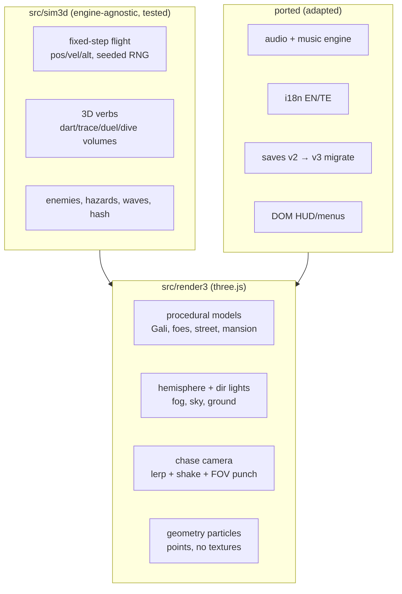

# Egara 3D — Full Flight Rebuild (APPROVED — blanket authorization)

Date: 2026-10-26 · Status: approved by owner (2.5D rejected; full 3D +
three.js + bespoke models chosen via questions).
This retires the 2D arena formula; it keeps names, story, chapters slate,
saves-shape (migrated), audio engine, i18n strings. New repo `egara-3d`
(the 2D game stays live until 3D surpasses it).

## 1. Goal

A true 3D flight game: Gali flies real 3D space (XZ + altitude), same story
beats re-staged volumetrically — dart through the car window, trace the
threat across a cracked windshield plane, circle-strafe the duel, dive the
cannon. WebGL2 floor (three.js WebGLRenderer), WebGPU as progressive
enhancement later, 60 fps mid-tier target with adaptive quality from day one.

## 2. Non-goals (v1-3D)

- No multiplayer, backend, accounts, ads, monetization.
- No film stills/songs/likenesses. No AI-image assets (code-built models).
- No physics engine: arcade flight model, custom fixed-step deterministic sim.
- No editor dependency: all content is data + procedural builders (diffable).

## 3. Alternatives considered

| Option | Verdict |
|---|---|
| 2.5D diorama over 2D sim | Rejected by owner. Keeps the old feel. |
| Babylon 9 + Havok | Rejected by owner (three.js chosen). Heavier runtime. |
| Godot/Unity web export | Rejected. Multi-MB wasm, hosting friction, kills static simplicity. |
| Keep 2D, more polish | Rejected by owner ("didn't like 2D at all"). |
| **three.js full flight (chosen)** | MIT, WebGL2 fallback, we own sim+models, static hosting intact. |

## 4. Architecture

Interfaces: sim3d exposes step(world, input) + hash; render3 reads state only.
Chapters are data (`src/content3/<id>.json`): volumes, waves, spawn points,
briefing strings (EN/TE keys reused where possible).

## 5. Phases (each its own gate)

- **P0 vertical slice** (this plan): greybox flight + 1 enemy + sting/score/
  lives + HUD + audio unlock + fps gate + deploy. Ship bar: plays at 60 fps
  on mid-tier, live URL green.
- **P1 crash in 3D**: eye-dart volumes + trace planes + crash cinematic.
- **P2 all chapters**: duel, escort, cannon dive, remaining beats.
- **P3 ship**: quality tiers, perf doc, hub link, sunset plan for 2D.

## 6. Lean check

| Part | Rung | Why |
|---|---|---|
| Engine, math | 5 | three.js + own fixed-step sim; no physics lib |
| Models | 7 | procedural low-poly builders; zero downloads |
| Particles | 6 | geometry points, no textures |
| Audio/i18n/saves | 2 | port proven v2 modules |
| HUD/menus | 3 | DOM/ARIA, canvas never carries text |

## 7. Open questions (answered)

1. Scope: full 3D flight (owner). 2. Engine: three.js (owner).
3. Models: bespoke procedural (owner). 4. Repo: new `egara-3d`, 2D stays live.
5. Camera: chase-follow (this design; revisit after slice if it feels wrong).
