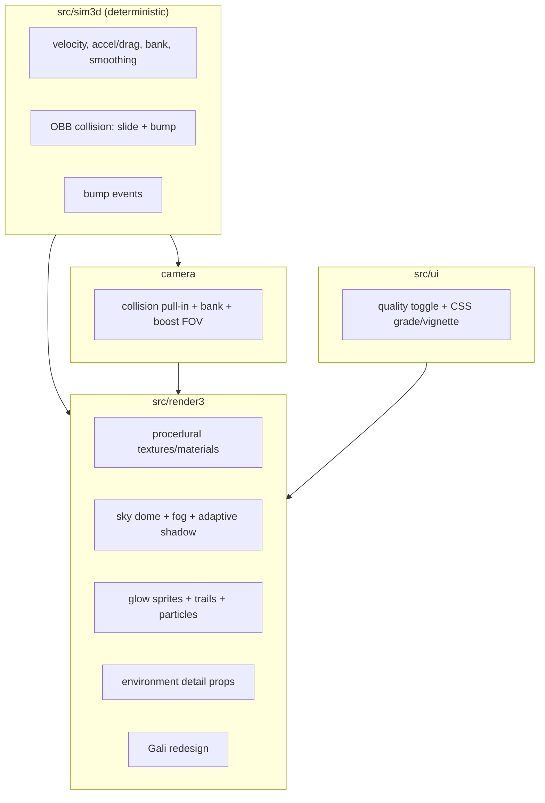

# Egara 3D — Feel & Visual Upgrade (P4)

Date: 2026-10-26 · Status: approved by owner direction (“game physics can be
better and graphics need to improve alot”; standing blanket authorization).
Parent: `docs/specs/2026-10-26-story-mode-3d.md` (story complete).
Research: `docs/research/2026-10-26-eega-world.md`.

## 1. Goal

Raise the game from a functional greybox to a **cinematic macro-noir** flight
game without adding assets, dependencies or a backend. Two tracks:

1. **Physics feel:** inertia, acceleration/drag, banking, speed-dependent
   turning, accurate rotated-box collision with slide + bump feedback, camera
   collision, and smoothed input.
2. **Graphics:** procedural textures on all major surfaces, a gradient sky,
   one adaptive directional shadow, fake glow, wing trails, speed lines, denser
   environment props, a redesigned Gali, and a subtle CSS grade/vignette.

The measurable bar: every chapter screenshot reads as a lit, textured place
(not flat boxes); flight has visible momentum and bank; collisions never
teleport; camera never clips through a wall; 60 fps target on mid-tier with
adaptive quality.

## 2. Non-goals

- No new chapters, story changes, multiplayer, backend, accounts, monetization.
- No downloaded art/audio packs, no PBR texture sets, no external fonts.
- No full 6DOF simulator, no physics engine (cannon-es/Rapier), no postprocessing
  composer (bloom/SSAO) — too heavy for the static/mobile footprint.
- No photoreal likenesses or film assets.

## 3. Alternatives considered

| Option | Verdict |
|---|---|
| Full PBR + real-time shadows everywhere + bloom/SSAO composer | Rejected: mobile GPU risk, bundle/complexity. |
| Toon/cel-shaded restyle | Rejected: fights the film’s glossy macro look. |
| Download a CC0 low-poly city/prop pack | Rejected: owner chose bespoke models; hosting/download weight. |
| **Procedural textures + gradient sky + one adaptive shadow + fake glow + detail props (chosen)** | Highest visual jump per KB and per frame. |
| Keep direct-position flight; add screen shake only | Rejected: the complaint is feel, not juice. |
| **Velocity-based arcade flight + OBB slide + camera collision (chosen)** | Momentum and contact without a physics engine. |
| Full 6DOF / gravity sim | Rejected: unreadable on touch, breaks the story tuning. |

**Y-statement:** in a static three.js story game, facing a flat greybox look and
direct-position flight, I chose procedural cinematic materials plus inertial
arcade flight, accepting that shadows and glow must be faked or adaptive rather
than physically complete.

## 4. Architecture

## 5. Physics model

- **State:** `player.vel{x,y,z}`, `speed`, `roll`, `smoothedTurn`,
  `smoothedClimb`.
- **Turn:** target from input; approach with a turn-response rate; yaw rate
  scales with current speed (slow = sluggish, boost = sharp); roll target =
  `-turn * rollLimit`, smoothed.
- **Speed:** base + boost, minus climb cost, plus dive gain; accelerate toward
  target with drag. No gravity; altitude clamp with soft bounce.
- **Collision:** rotated-box closest-point resolution against every `Building`
  (x,z,w,d,rot,h); push out along the contact normal, remove inward velocity,
  keep tangential slide, lose speed, emit a bump event. Arena edge uses the same
  response.
- **Camera collision:** sphere-cast/segment test from the player to the desired
  camera position against buildings; pull in to the first hit minus a margin.
- **Input:** keyboard/touch values are smoothed over ~0.15 s; releases ease back.
- **Determinism:** all state in the world; same seed + input log → same hash.
- **Bump feedback:** render sparks, shake (reduced-motion aware), thud audio,
  short speed loss.

## 6. Visual model

- **Palette:** per chapter, deep indigo shadows, warm sodium/amber practicals,
  one accent (gold, ember, ritual orange). Fog matches the sky horizon.
- **Textures:** runtime canvas textures (no downloads): concrete, asphalt,
  wood grain, marble veins, paper/fabric weave, brushed metal, window grids.
  Repeat/wrap; cache by key; use `SRGBColorSpace`.
- **Materials:** `MeshStandardMaterial` for hero/near props, `MeshLambertMaterial`
  for background masses; lower flat-shading on organic forms; emissive windows,
  signs, lamps, shards.
- **Sky:** one shader dome (zenith/horizon/ground + sun/moon glow) + stars.
- **Lighting:** hemisphere + one directional key + one point accent. High
  quality: directional shadow map (1024, PCF soft) on Gali/key actors and ground;
  low quality: no shadow pass, blob shadow only. Adaptive: disable shadows when
  FPS < 48.
- **Glow:** additive sprite halos (canvas radial gradient) on shards, lamps,
  fire, chandelier, car lights — a fake bloom at near-zero cost.
- **Hero:** Gali redesign — thorax/abdomen, compound-eye highlights, antennae,
  six legs, stinger, iridescent double wings, wing blur, body bob, bank, trail.
- **Effects:** wing trail, boost speed lines, dust motes, embers, smoke, splash/
  impact sparks, fire flicker. All pooled.
- **Environment detail:** facades/windows/AC units/awnings/cables/water tanks/
  puddles/signs in the lane; jars/tools/paper/magnifier in the workshop; rugs/
  paintings/plants/glassware in Garva House; road signs/reflectors/guardrails/
  skyline at the airport; drapes/charms/glyphs in the ritual room; broken glass/
  embers in the finale.
- **Grade:** CSS vignette + grain + subtle warm/cool split; no GPU post pass.
- **UI:** quality toggle (High/Low) in pause; reduced-motion disables shake/FOV
  punch; the grade respects reduced-motion.

## 7. Requirements

| ID | Requirement |
|---|---|
| P1 | Flight has acceleration, drag, speed-dependent turn, bank and dive/climb speed trade. |
| P2 | Rotated-box collision resolves with slide + bump, never teleports. |
| P3 | Camera pulls in before walls; bank/boost FOV; no clipping in any chapter. |
| P4 | Keyboard/touch input is smoothed without adding perceptible lag. |
| P5 | Every chapter has at least three textured material families and one unique detail cluster. |
| P6 | Gradient sky + stars/moon; fog matches; no flat void. |
| P7 | Adaptive shadow: high quality shadows, low quality blob; auto-fallback under 48 fps. |
| P8 | Glow sprites on shards/lamps/fire/car; wing trail; boost speed lines. |
| P9 | Gali redesign reads at chase distance; one-wing state still visible. |
| P10 | CSS grade/vignette + grain; reduced-motion safe. |
| P11 | Quality High/Low toggle persists; low keeps 60 fps. |
| P12 | Draw calls <150 high (excluding shadow pass), <90 low; bundle ≤200 KB gz app. |
| P13 | All 61 unit tests + 12 smoke stay green; new physics/camera tests added. |
| P14 | Live Pages deploy, live smoke 200, perf table rows. |

## 8. Phases

- **P4a (this gate):** physics + camera + render foundation + hero/effects +
  environment detail + quality toggle + ship.
- P5 (later): audio score motifs, remaps, device perf, more animation.

## 9. Lean check

| Part | Rung | Why |
|---|---|---|
| Physics | 6 | velocity/steering math in the existing fixed-step loop |
| Collision | 6 | OBB closest-point function; no engine |
| Textures | 7 | runtime canvas; zero downloads |
| Sky/glow | 7 | shader dome + sprites; no composer |
| Shadows | 5 | three.js built-in, one light, adaptive |
| Detail props | 2 | extend existing procedural builders |
| Grade | 3 | CSS gradients/SVG noise |
| Quality | 3 | one setting + auto fallback |

## 10. Decisions

1. Visual direction: cinematic macro-noir, not toon or photoreal.
2. No postprocessing composer; fake glow + CSS grade.
3. One adaptive shadow light; high/low toggle.
4. Arcade inertia + OBB slide, no physics engine.
5. Procedural textures only.
6. Existing story/content/tuning values remain authoritative; physics adds
   feel without changing chapter goals.

## 11. Open questions

- Whether real shadows survive on the target phone (device run).
- Exact texture resolution budget (start 256², raise to 512² for hero surfaces).
- Whether camera collision needs a spring or a hard pull-in (start hard with
  0.15 s smoothing).
