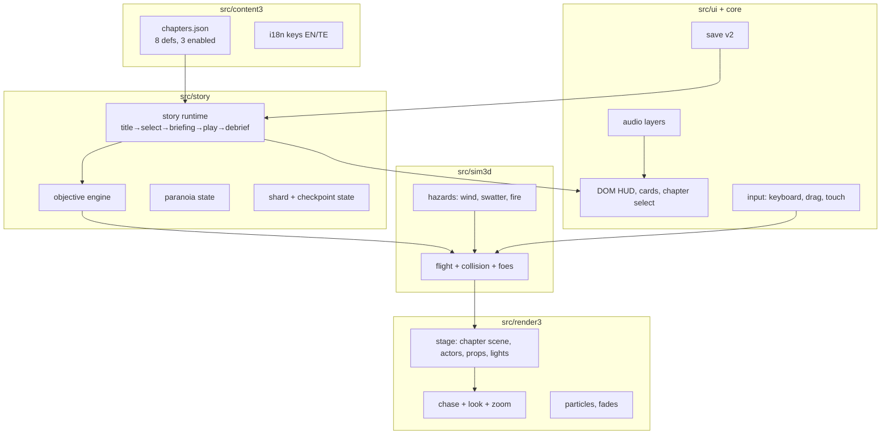
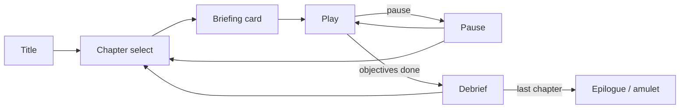

# Egara 3D — Story Mode & World Enrichment (APPROVED)

Date: 2026-10-26 · Status: approved by owner (explicit direction: “start enriching
game with world building, game chapters etc”; standing blanket authorization).
Parent: `docs/specs/2026-10-26-egara3d.md` (P0 slice, gate closed).
Research: `docs/research/2026-10-26-eega-world.md` (world bible, ~30 sources).

## 1. Goal

Turn the P0 flight slice into a story game. The player flies Gali through a
volumetric, fly-scale Nagaram; each chapter is a self-contained 5–10 minute
flight mission with one new verb, one world-building reveal, and one emotional
beat. Deliver the first three chapters now, on the existing static, no-backend
footprint, with the remaining five specified and gated as later phases.

**Acceptance criteria for this gate**
- Title → chapter select → Chapter 1 playable in under 20 s on a cold load.
- Chapters 1–3 are distinct, playable, and completable; each has objectives,
  story cards, shards, a fail/checkpoint loop, and a debrief.
- 12 memory shards across ch.1–3 (4 each), persisted; chapter select enforces
  progression.
- EN/TE toggle covers all shipped UI and story text.
- 60 fps headless Chromium; draw calls < 120; no console errors; WebGL fallback
  still explains itself; Pages live and smoke-tested.
- Save v1 → v2 migration preserves mute and best score.

## 2. Non-goals

- No multiplayer, backend, accounts, ads, analytics, monetization — ever.
- No film IP: original names, places, models, text, audio. No stills, likenesses,
  songs, lyrics, or “Eega” in shipped content.
- No physics engine, no open world, no cutscene video, no voice acting.
- No human-playable prologue; the game is a fly game from the first input.
- No full 8 chapters in this gate. Chapters 4–8 are specified, not built.

## 3. Alternatives considered

| Option | Verdict |
|---|---|
| Keep the endless scorer; add skins | Rejected: no arc, no world, no characters. |
| Framework + Chapter 1 only | Rejected: too thin; no ally, no workshop, no scale contrast. |
| Framework + Chapters 1–3 (chosen) | Establishes rebirth, memory/world, ally/workshop; three distinct spaces; no boss complexity. |
| Framework + Chapters 1–4 | Rejected for this gate: airport-road car/wiper render and physics add risk before the loop is proven. |
| All 8 chapters at once | Rejected: cannot verify quality, perf or narrative in one pass. |
| 2.5D diorama | Rejected by owner (P0 decision). |

**Y-statement:** in a proven 3D flight slice, facing the need for story and world
building, I chose a three-chapter story gate to establish the loop and the world,
accepting that the finale and boss chapters ship in later gates.

## 4. Architecture

**Interfaces**
- `ChapterDef` (content): id, title/subtitle EN+TE, location, palette, bounds,
  spawn, objectives, waves, shards, hazards, cards, unlock.
- `StoryState` (sim): chapterId, objective index/progress, shards, paranoia,
  checkpoint, lives, events, phase.
- `stepStory(state, input)` runs after the fixed flight step; emits events.
- `Stage.loadChapter(def)` rebuilds the scene; `Stage.sync(state)` reads only.
- `SaveData v2`: `{v:2, muted, lang, best, chapters, shards, amulet}`; migration
  from v1 in a pure parser.
- Runtime states: `title`, `select`, `briefing`, `playing`, `paused`, `debrief`.

## 5. Chapter slate

| # | Title | Space | New verb | Beat | Gate |
|---|---|---|---|---|---|
| 0 | The Storyteller | bench/hub | — | frame, chapter select, glass wing | P1 |
| 1 | First Flight | Punnami Lane, night | fly, boost, perch | rebirth; 4 memory shards; first strike bounces; murder remembered | P1 |
| 2 | The Locket | lane + balcony, blackout | carry, light-beacon | recover the locket; Shilpi sees Gali; name in tears | P1 |
| 3 | The Workshop | Shilpi's desk | sting, message | trust; needle harness; Garva's car below | P1 |
| 4 | The Airport Road | highway + car | write-on-glass, slipstream | first victory; crash; threat | P2 |
| 5 | Haunt the House | Garva House + ledger room | sabotage, fire | paranoia; burn the black money | P2 |
| 6 | The Diviner | ritual room / burning house | smoke, ember ride | midpoint reversal; boss | P2 |
| 7 | The Glass House | mansion | vent travel, perch stealth | Venu's policy; Shilpi taken | P3 |
| 8 | The Cannon | glass house, fire | one-wing flight, chain reaction | sacrifice finale; Garva | P3 |
| E | The Wing | bench | — | amulet; NG+ | P3 |

Chapter length: 5–10 min first play, 3–5 on replay. One new verb per chapter;
combine with the previous verb mid-chapter; mastery test at the end.

## 6. Systems

### 6.1 Objectives
Data-driven, evaluated by the sim each step. Kinds for P1: `reach` (sphere),
`collect` (shard ids), `survive` (seconds), `write` (arrange marks at a target),
`destroy` (foes/target). Kinds `escort`, `boss` are defined in the schema and
implemented in P2/P3. Objectives complete sequentially; completing the last one
ends the chapter (unless a card is pending).

### 6.2 Memory shards
12 across P1 (4/4/4). Each shard is a world object with an id, position, caption
EN/TE, and a short visual vignette (colour pulse, particle motif). Pickup persists
in the save. Shards are optional for completion, required for the epilogue/NG+ in
P3; chapter select shows `x/4`.

### 6.3 Paranoia
`0–100` in `StoryState`. P1 uses it as a quiet world-state dial: lights, patrol
drones, fog tint, audio layer. It rises with sabotage and time; it never gates
progression in P1. P2 uses it to drive spawns, traps and Garva's behaviour.

### 6.4 Hazards
- **Wind zones** (lane): directional force, visible dust streaks, audio layer.
- **Swatter** (First Flight): a timed plane that telegraphs with a shadow and a
  wind-up sound; contact costs a life.
- **Tweezers / lamp** (Workshop): moving obstacle and heat zone; contact costs a
  life; the lamp is also a light beacon.
- **Checkpoint:** last collected shard or chapter start; respawn in <2 s, keep
  shards, restore 3 lives.
- **No fall damage, no HP bar:** three lives, invulnerability window, readable
  hurt feedback.

### 6.5 Dialogue-free storytelling
- Storyteller cards: 1–3 sentences, EN/TE, letterboxed, dismiss with Space/click.
- Environmental writing: dust/tears/ash marks; the `write` objective asks the
  player to fly through a sequence of marks; Shilpi reacts.
- Memory shards: 1–2 line captions; no voice.
- Character expression: hover bob, wing pitch, head tilt, body roll, stinger
  pulse, trail colour; human reactions (Shilpi's hand, Garva's face) carry tone.

### 6.6 World building in P1
- **Punnami Lane:** low-rise, balconies, grilles, tangled cables, a blackout, a
  satellite dish and foil reflector, warm windows, a hand as the scale ruler.
- **Shilpi's Workshop:** bench-top scale, magnifier lamp, tweezers, lead
  shavings, a mug, a matchbox, the pencil-lead locket.
- **Shilpi:** stylised low-poly maker at ~100× fly scale; her hands are terrain.
- **Garva:** introduced as a car, a voice through glass, a shadow; his face is
  held for the first time in the Chapter 2 card. No boss in P1.
- **The Storyteller's bench:** hub backdrop — lamp, glass wing, city beyond.

### 6.7 Audio
Reuse the synth engine. Add layers: buzz (always), wind (outdoor), room tone
(indoor), tension (paranoia), and stingers for shard/objective/hurt. Mute persists.
No music assets; a slow three-note motif for the Storyteller.

### 6.8 Saves and i18n
- Save key stays `egara3d.save`; v2 with v1 migration.
- Language toggle EN/TE in title and pause; persisted. All shipped strings must
  have both languages.
- Chapter progress, shards, best time, mute, lang.

### 6.9 Accessibility and input
- Keyboard: WASD/arrows, Shift boost, Space sting/interact, P/Esc pause.
- Mouse: drag look, wheel zoom.
- Touch: left-side virtual stick (turn/climb), right-side drag look, tap button
  for sting/boost. Large targets, no precision requirement.
- `prefers-reduced-motion` and a pause toggle disable shake/FOV punch.
- WebGL failure keeps the existing readable fallback.

## 7. UX flow

- First run: title → Chapter 1 briefing → play (no chapter select detour).
- Chapter select: 8 cards; locked cards show a silhouette + “locked”; completed
  cards show shards and best time.
- In-game HUD: objective line, shards `x/4`, subtle paranoia pips, pause/mute.
- Cards never block input longer than a dismiss; Space/click advances.
- Debrief: chapter title, shards, time, next chapter; no score-shaming.

## 8. Requirements

| ID | Requirement |
|---|---|
| R1 | `ChapterDef` schema + 8 chapter definitions; 3 enabled in P1. |
| R2 | Story runtime state machine with title, select, briefing, play, pause, debrief. |
| R3 | Objective engine supports reach, collect, survive, write, destroy; sequential completion. |
| R4 | 12 shards (4/4/4), persisted, caption EN/TE, checkpoint on pickup. |
| R5 | Three lives, invulnerability, checkpoint respawn <2 s, no lost shards. |
| R6 | Hazards: wind, swatter, tweezers/lamp; readable telegraphs. |
| R7 | Paranoia 0–100 exposed to render/audio; no progression gate in P1. |
| R8 | Three distinct 3D environments + hub, built procedurally, shared sim layout. |
| R9 | Shilpi model and presence; dialogue-free reaction beats. |
| R10 | DOM title, chapter select, briefing, HUD, cards, pause, debrief; ARIA. |
| R11 | EN/TE toggle for all shipped strings; persisted. |
| R12 | Save v2 with v1 migration; chapter/shards/best/mute/lang. |
| R13 | Touch input (stick + drag look + sting/boost) and keyboard/mouse. |
| R14 | Audio layers: buzz, wind, room, tension, stingers; mute. |
| R15 | Perf: 60 fps headless, draw calls <120, bundle ≤200 KB gz app code (excl. three). |
| R16 | WebGL fallback preserved; no console errors in smoke tests. |
| R17 | e2e: title→ch1→shard→objective→debrief; chapter select lock; save reload. |
| R18 | Deploy to Pages; live smoke 200; perf table row. |

## 9. Lean check

| Part | Rung | Why |
|---|---|---|
| Flight sim, camera, particles | 2 | reuse P0; add objectives/hazards only |
| Chapter content | 7 | data-driven JSON; no chapter logic in code |
| Environments | 7 | procedural primitives + shared layout; no downloads |
| Shilpi/Garva models | 7 | low-poly primitives; silhouette-first |
| Story cards | 3 | DOM text; no cutscene system |
| Save v2 | 2 | extend proven parser with migration |
| i18n | 3 | dictionary + toggle; no library |
| Touch | 3 | pointer events + a DOM stick; no library |

## 10. Phases

- **P1 (this gate):** framework + hub + chapters 1–3 + save v2 + EN/TE + deploy.
- **P2:** chapters 4–6 (airport road, haunt/ledger, Diviner boss) + paranoia
  gameplay + Garva institution nodes prototype.
- **P3:** chapters 7–8 + Garva boss + epilogue/amulet + NG+.
- **P4:** perf/device run, accessibility audit, remaps, polish, release notes.

## 11. Decisions

1. Chapter order: rebirth first; the ordinary world is recovered through memory
   shards. The film's setup becomes playable memory, not a human prologue.
2. Three chapters in P1; the remaining five are specified now, built later.
3. Original canon: Gali, Shilpi, Garva, Nagaram, Punnami Lane, Garva House,
   The Glass House, The Diviner, Venu, The Aide, Kiran, The Storyteller.
4. The Storyteller frame replaces the film's parent/child bedtime scene.
5. No score in story mode; completion, shards and time are the rewards.
6. `egara3d.save` v2; no new storage key.

## 12. Open questions

- Exact Telugu copy for all cards (translated in the content task; reviewed for
  naturalness, not literal fidelity).
- Whether touch controls need a dedicated tutorial card (decide after device test).
- Chapter 4 car physics: kinematic path vs simulated, decided in the P2 gate.
- Boss node model for Garva: four nodes vs three, decided in the P3 gate.
