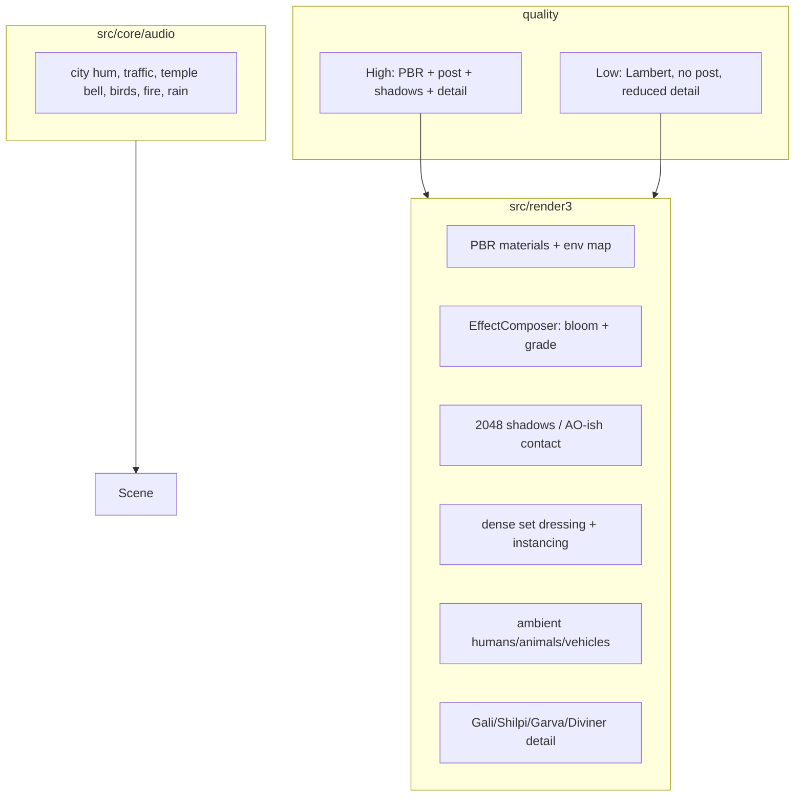

# Egara 3D — World Realism (P6)

Date: 2026-10-26 · Status: approved by owner direction (“make it as realistic as
possible close to movie, no limitations just move forward”; standing blanket
authorization). Parent: story complete; P5 control/perch gate closed.

## 1. Goal

Make Nagaram feel like a real Indian metro seen from a fly: dense, lived-in,
lit, atmospheric. Close to the film’s **world** — scale contrast, middle-class
lane, maker’s workshop, glass mansion, airport road, ritual room, burning house
— with original assets and no copied shots, likenesses, stills or songs.

Two quality tiers:
- **High:** PBR materials, environment reflections, 2048 shadows, bloom, film
  grade, full detail, ambient humans/animals/vehicles, richer audio.
- **Low:** Lambert fallback, no post/shadows, reduced detail, same layout.

## 2. Non-goals

- No film stills, posters, actor likenesses, songs, lyrics, dialogue, or
  shot-for-shot recreations.
- No backend, accounts, multiplayer, monetization.
- No new story chapters or mechanics.
- No photoreal human faces; stylised-realistic proportions/clothing only.
- No downloaded art packs by default; procedural textures/models (CC0 could be
  introduced later with a licence record).

## 3. Alternatives considered

| Option | Verdict |
|---|---|
| Keep the P4 stylised look; add a few props | Rejected: owner asked for realism. |
| Download CC0 city/character packs | Rejected for now: fit/licence/asset review overhead; procedural gives control. |
| Full photoreal + path tracing | Impossible in browser/static budget. |
| **Procedural PBR + env map + post + dense detail + ambient life (chosen)** | Highest realism per KB/frame, original, tunable. |
| Keep Lambert only, add post | Cheaper but flat; PBR is the realism lever. |
| Photoreal human faces | Rejected: uncanny and likeness risk. |

**Y-statement:** in a browser/static game, facing a request for film-close
realism, I chose procedural PBR, environment reflections, cinematic post,
dense original set-dressing and ambient life, accepting that faces stay
stylised and the heaviest tier needs a real GPU.

## 4. Architecture

## 5. Realism levers

- **Materials:** `MeshStandardMaterial` with albedo/bump/roughness/metalness,
  512–1024 procedural maps; skin/fabric/marble/wood/concrete/asphalt/metal/
  window/paper; env-map reflections; emissive practicals.
- **Lighting:** hemisphere + key + practical points; 2048 PCF shadows high;
  contact/blob shadows low; warm sodium vs cool moonlight; fire practicals.
- **Post (high):** EffectComposer → bloom → custom grade (vignette, grain,
  saturation, warm/cool split) → output; tone mapping ACES.
- **Scale:** every scene gets human-scale rulers (hands, cups, pencils, doors,
  vehicles, birds) so the fly reads tiny.
- **Density:** shopfronts, balconies, grilles, ACs, tanks, cables, laundry,
  festival lights, temple corner, tea stall, auto-rickshaw, scooters, bins,
  puddles, transformer, pigeons, dog; workshop tools/jars/sketches; mansion
  marble/art/plants/bar/security; airport gantries/terminal/planes/traffic;
  ritual brass/charms/smoke; finale fire/glass/embers.
- **Life:** low-poly humans with idle loops (shopkeeper, passer-by, guard,
  child), animals, vehicles, drifting paper/dust/embers/rain.
- **Sound:** city hum, distant traffic, temple bell, birds, dog, room tone,
  fire crackle, rain; synth layers tied to chapter/paranoia.
- **Camera/finish:** subtle FOV, letterbox cards, grade; no shaky-cam by default.

## 6. Requirements

| ID | Requirement |
|---|---|
| W1 | High tier: PBR materials + env reflections + bloom/grade + 2048 shadows. |
| W2 | Low tier: Lambert fallback, no post, no shadows, reduced detail; persists. |
| W3 | Punnami Lane: ≥8 landmark clusters (shopfronts, temple corner, tea stall, auto, scooters, dog/pigeons, festival lights, transformer/blackout). |
| W4 | Workshop: ≥6 detail clusters (tools, jars, sketches, locket, lamp, dawn window). |
| W5 | Garva House: ≥8 luxury clusters (marble, art, plants, bar, chandelier, skyline, security, safe/ledger). |
| W6 | Airport/ritual/finale: terminal/planes/traffic; brass/smoke/charms; fire/glass/embers. |
| W7 | Ambient humans/animals/vehicles with idle motion; no likenesses. |
| W8 | Realistic-proportion Gali, Shilpi, Garva, Diviner; clothing/detail upgrade. |
| W9 | Audio: city/traffic/bell/birds/fire/rain layers per chapter. |
| W10 | High draw calls <220, low <100; adaptive scale; 60 fps target. |
| W11 | All tests + live deploy stay green; no film IP assets. |

## 7. Lean check

| Part | Rung | Why |
|---|---|---|
| PBR/post | 5 | three.js addons already in the package |
| Textures | 7 | procedural canvas; no downloads |
| Set dressing | 2 | extend existing procedural builders |
| Instancing | 3 | InstancedMesh for repeated detail |
| Humans/animals | 7 | low-poly primitives, no likeness |
| Audio | 6 | WebAudio noise/oscillator layers |
| Quality | 3 | existing High/Low setting |

## 8. Decisions

1. Realism route: procedural PBR + post + density + life, not asset packs.
2. Faces stay stylised; no actor likenesses.
3. High tier is GPU-targeted; low remains the safe mode.
4. Film-close means mood/scale/settings/material culture, not copied frames.
5. Keep the existing story, controls and chapter goals.

## 9. Open questions

- Whether real-device high tier holds 60 fps after bloom/shadows.
- Whether ambient humans read at fly scale without becoming clutter.
- Whether a subtle DOF pass is worth the cost.
